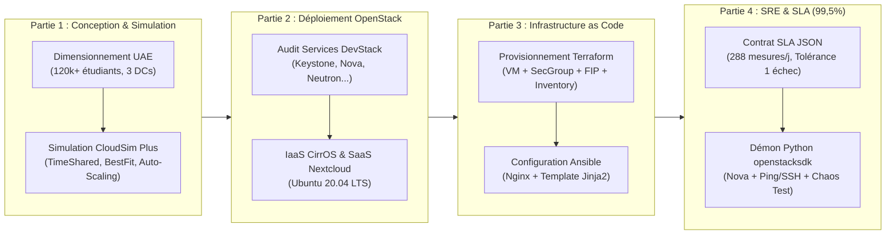
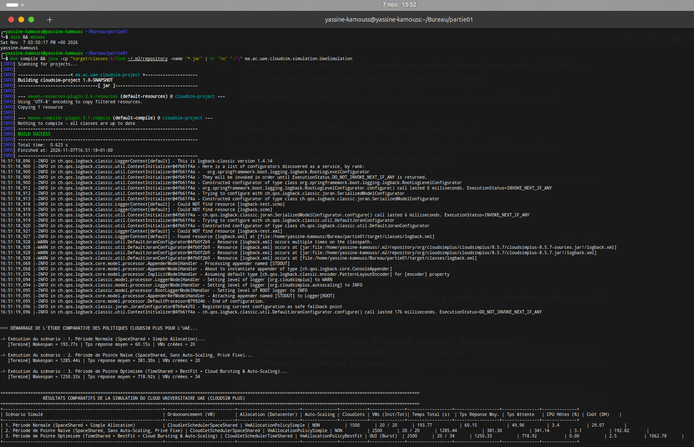
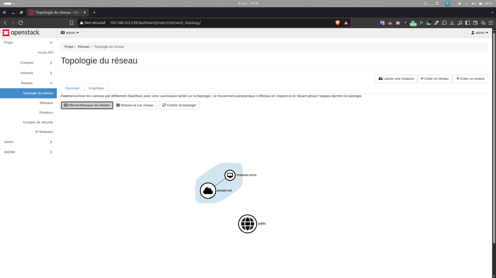
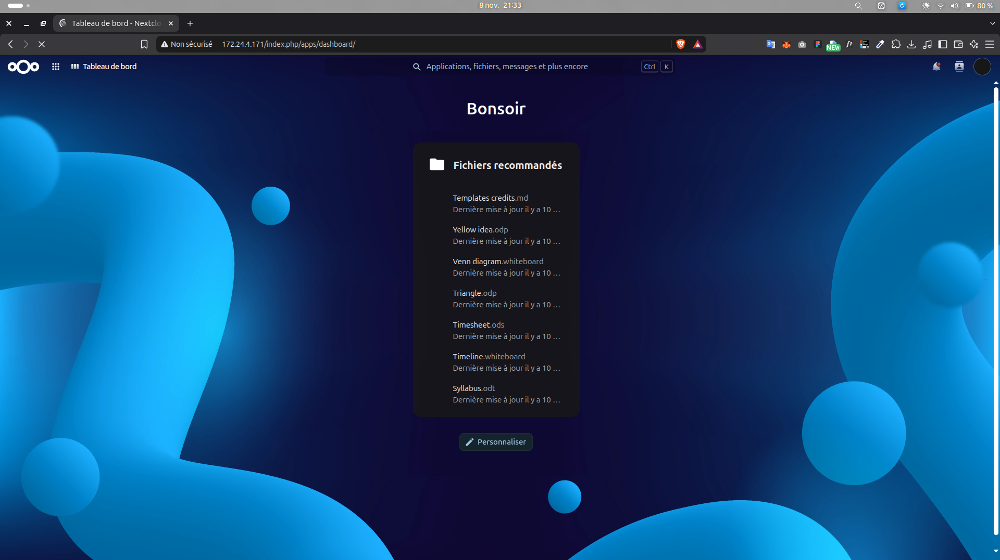
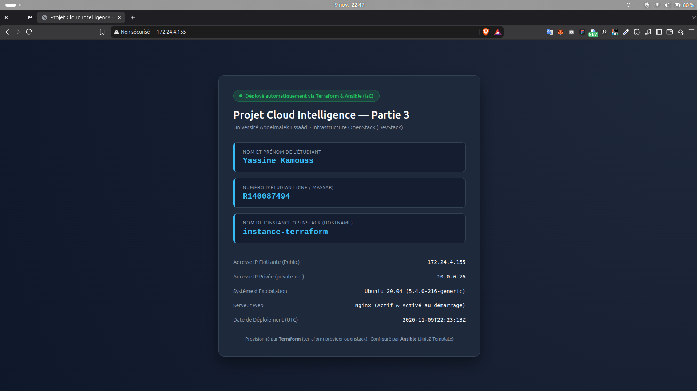
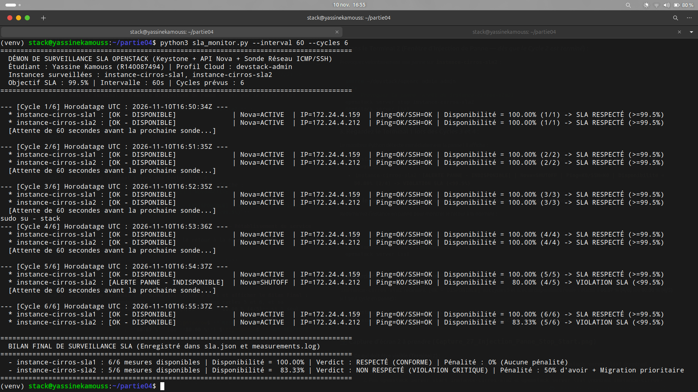

# Cloud Intelligence : Simulation CloudSim Plus, OpenStack (IaaS/SaaS), IaC (Terraform/Ansible) & Surveillance SLA


> **Projet de fin de partie : Cloud Intelligence**  
> **Réalisé par :** **Yassine Kamouss** (Numéro d'étudiant : **`R140087494`**)  
> **Encadré par :** **Prof. C. EL AMRANI**  
> **Établissement :** **Université Abdelmalek Essaâdi (UAE)**  

---

## Navigation Rapide vers les Rapports Complets par Partie

| Partie du Projet | Rapport Complet Consolidé | Rapports Détaillés par Question | Dossier des Livrables & Code |
| :--- | :--- | :--- | :--- |
| **Partie 1 — Simulation CloudSim Plus** | [**`Rapport_Partie1_CloudSim.md`**](./docs/Rapport_Partie1_CloudSim.md) | [`01_02_recherche_architecture.md`](./partie01/docs/01_02_recherche_architecture.md)<br>[`03_modelisation_charges.md`](./partie01/docs/03_modelisation_charges.md)<br>[`04_simulation_politiques.md`](./partie01/docs/04_simulation_politiques.md)<br>[`05_resultats_analyse.md`](./partie01/docs/05_resultats_analyse.md) | [**`./partie01/`**](./partie01/) |
| **Partie 2 — OpenStack : IaaS & SaaS** | [**`Rapport_Partie2_OpenStack_IaaS_SaaS.md`**](./docs/Rapport_Partie2_OpenStack_IaaS_SaaS.md) | [`Partie2_Question1.md`](./docs/Partie2_Question1.md)<br>[`Partie2_Question2.md`](./docs/Partie2_Question2.md)<br>[`Partie2_Question3.md`](./docs/Partie2_Question3.md) | [**`./partie02_openstack/`**](./partie02_openstack/) |
| **Partie 3 — IaC : Terraform & Ansible** | [**`Rapport_Partie3_Terraform_Ansible_IaC.md`**](./docs/Rapport_Partie3_Terraform_Ansible_IaC.md) | [`Partie3_Question1.md`](./docs/Partie3_Question1.md)<br>[`Partie3_Question2.md`](./docs/Partie3_Question2.md)<br>[`Partie3_Question3.md`](./docs/Partie3_Question3.md) | [**`./partie03/`**](./partie03/) |
| **Partie 4 — Contrat SLA & Monitoring SRE** | [**`Rapport_Partie4_SLA_Surveillance.md`**](./docs/Rapport_Partie4_SLA_Surveillance.md) | [`Partie4_Question1.md`](./docs/Partie4_Question1.md)<br>[`Partie4_Question2_3.md`](./docs/Partie4_Question2_3.md)<br>[`Partie4_Question4_5.md`](./docs/Partie4_Question4_5.md) | [**`./partie04/`**](./partie04/) |

---

## Vision Globale et Approche d'Ingénierie

Ce dépôt regroupe l'intégralité des travaux d'ingénierie réalisés pour le projet **Cloud Intelligence**. Plutôt qu'une juxtaposition d'exercices indépendants, le projet a été conduit selon le cycle de vie complet d'une infrastructure Cloud de production :



---

## Synthèse des 4 Parties Réalisées

### Partie 1 — Simulation d'un Cloud Universitaire Hybride avec CloudSim Plus
* **Contexte UAE :** Modélisation des **16 établissements** (~120 000+ étudiants, ~2 500 enseignants) répartis sur 6 villes (Tétouan, Tanger, Al Hoceïma, Larache, Ksar El Kébir, Chefchaouen) et des services numériques critiques (**Apogée**, **Moodle LMS**, **ENT/CAS**).
* **Architecture Hybride à 3 Datacenters :**
  * **DC1 (Privé — Tétouan)** & **DC2 (Privé — Tanger)** : $2 \times 10\text{ serveurs}$ de 64 cœurs / 256 Go RAM pour la souveraineté des données académiques.
  * **DC3 (Public — Cloud Bursting)** : Débordement élastique à la demande (`HorizontalVmScaling` déclenché dès $\text{CPU} > 80\%$).
* **Résultats clés de la simulation Java (CloudSim Plus v8.5.7) :**

| Scénario Simulé | Ordonnancement (VM) | Allocation (DC) | Auto-Scaling | Cloudlets | VMs (Init/Tot) | Temps Total (s) | Tps Attente Moy. (s) | Coût (DH) |
| :--- | :--- | :--- | :---: | :---: | :---: | :---: | :---: | :---: |
| **1. Période Normale** | `SpaceShared` | `Simple` | NON | 1 500 | 20 / 20 | 193,77 | 49,96 | 29,07 |
| **2. Pointe Naïve (Privé fixe)** | `SpaceShared` | `Simple` | NON | 2 500 | 20 / 20 | 1 285,44 | **341,14** | 192,82 |
| **3. Pointe Optimisée (Hybride)** | `TimeShared` | `BestFit` | **OUI (DC3)** | 2 500 | **20 / 34** | **1 250,33** | **0,00** | 1 062,78 |



---

### Partie 2 — OpenStack : IaaS (CirrOS) et SaaS (Ubuntu Server / Nextcloud)
* **Question 1 — Audit de l'architecture DevStack :** Validation du tableau de bord **Horizon** (`http://192.168.123.239/`) et audit CLI (`openstack service list`, `openstack compute service list`, `openstack network agent list`) avec analyse fonctionnelle de **Keystone**, **Nova**, **Glance**, **Neutron**, **Placement** et **Cinder**.
* **Question 2 — Déploiement IaaS avec CirrOS :** Création reproductible en CLI du réseau `private-net` (`10.0.0.0/24`), du routeur `router1` relié à la passerelle externe `public`, du groupe de sécurité `secgroup-cirros` (ICMP + TCP/22), de la paire de clés `key-cirros`, du gabarit `m1.nano` et de l'instance `instance-cirros` associée à l'IP flottante `172.24.4.10`, validée par `ping` et `ssh`.
* **Question 3 — Déploiement SaaS avec Ubuntu Server 20.04 & Nextcloud :** Création du gabarit `m1.saas` (1,5 Go RAM), importation de l'image officielle Cloud Ubuntu 20.04 LTS dans Glance, lancement de `instance-saas` (`172.24.4.171`), résolution des contraintes DNS/hosts de DevStack et déploiement de **Nextcloud** via Snap.




---

### Partie 3 — Infrastructure as Code : Terraform et Ansible
* **Question 1 — Provisionnement déclaratif avec Terraform (`partie03/terraform/`) :**
  * Authentification sécurisée sans secret en dur via `/etc/openstack/clouds.yaml` (`cloud = "devstack-admin"`).
  * Création déclarative du groupe de sécurité `secgroup-iac` (SSH/22, HTTP/80, ICMP), du port Neutron `port-instance-terraform`, de l'instance Ubuntu `instance-terraform` (`10.0.0.76`) et de son IP flottante `172.24.4.155`.
  * **Intégration continue Terraform $\rightarrow$ Ansible :** Génération automatique du fichier `partie03/ansible/inventory.ini` via la ressource `local_file.ansible_inventory` et le template `inventory.tftpl`.
* **Question 2 — Gestion de configuration avec Ansible (`partie03/ansible/`) :**
  * Playbook idempotent `playbook.yml` configurant la résolution réseau/MTU, installant et activant le serveur **Nginx** au démarrage, et déployant dynamiquement une page web via le template Jinja2 `templates/index.html.j2` affichant **Yassine Kamouss**, **R140087494** et **`instance-terraform`** (`{{ ansible_hostname }}`).
  * Clôture propre du cycle de vie via `terraform destroy -auto-approve`.
* **Question 3 — Étude comparative d'ingénieur :** Analyse multicritère entre **Provisionnement d'infrastructure (Terraform : IaaS, API Cloud, Stateful `.tfstate`, Immuable)** et **Gestion de configuration (Ansible : OS/App, SSH Agentless, Stateless, Mutable)**.



---

### Partie 4 — Service Level Agreement (SLA) et Surveillance Python (`openstacksdk`)
* **Question 1 — Contrat `sla.json` et Dimensionnement mathématique :**
  * Objectif de disponibilité : **99,5 %** sur une période quotidienne avec une mesure toutes les **5 minutes** ($\mathbf{288\text{ mesures/jour}}$).
  * **Tolérance de panne quotidienne :** Au maximum **$1\text{ seule mesure en échec}$** ($\frac{287}{288} = 99,65\% \ge 99,5\%$, tandis que 2 échecs donnent $\frac{286}{288} = 99,31\% < 99,5\%$), soit **$5\text{ minutes}$** de panne maximale en échantillonnage discret aux 5 minutes (**$7\text{ minutes et } 12\text{ secondes}$** en temps continu théorique).
* **Questions 2 & 3 — Démon Python `sla_monitor.py` :**
  * Connexion Keystone via `openstacksdk` (`devstack-admin`) et surveillance de deux instances CirrOS dédiées (`instance-cirros-sla1` sur `172.24.4.159` et `instance-cirros-sla2` sur `172.24.4.212`) tout en conservant `instance-cirros` et `instance-saas` intactes (`SHUTOFF`).
  * Double vérification : **Plan de contrôle (API Nova `status == ACTIVE`)** + **Plan de données (Ping ICMP et Socket TCP port 22 SSH)**.
* **Questions 4 & 5 — Injection de panne (`stop`/`start`) et Rapport intégré dans `sla.json` :**
  * Détection en temps réel de l'arrêt provoqué sur `instance-cirros-sla2` au Cycle 5 (`[ALERTE PANNE - INDISPONIBLE] | Nova=SHUTOFF`), baisse de disponibilité à **80,00 %** puis **83,33 %** (`VIOLATION CRITIQUE`), tandis que l'instance témoin `instance-cirros-sla1` maintient **100,00 %** (`RESPECTÉ`).



---

## Matrice de Conformité des Livrables (« À rendre » du Cahier des Charges)

| Partie | Livrable exigé par le Cahier des Charges | Emplacement exact dans ce dépôt |
| :---: | :--- | :--- |
| **Partie 1** | Schémas de l'architecture (Draw.io & PNG) | [`partie01/diagrams/`](./partie01/diagrams/) & [`partie01/pics/`](./partie01/pics/) |
| **Partie 1** | Code Java complet de la simulation CloudSim Plus | [`partie01/src/main/java/ma/ac/uae/cloudsim/`](./partie01/src/main/java/ma/ac/uae/cloudsim/) |
| **Partie 1** | Tableau des résultats et analyse | [`docs/Rapport_Partie1_CloudSim.md`](./docs/Rapport_Partie1_CloudSim.md) |
| **Partie 2** | Commandes CLI utilisées (Services, CirrOS IaaS, Ubuntu SaaS) | [`partie02_openstack/`](./partie02_openstack/) & [`docs/Rapport_Partie2_OpenStack_IaaS_SaaS.md`](./docs/Rapport_Partie2_OpenStack_IaaS_SaaS.md) |
| **Partie 2** | Captures d'écran (Horizon, topologie réseau, SSH, SaaS Nextcloud) | [`pics/Capture_01_Horizon.png`](./pics/Capture_01_Horizon.png) à [`pics/Capture_16_Navigateur_SaaS.png`](./pics/Capture_16_Navigateur_SaaS.png) |
| **Partie 3** | Fichiers Terraform (`.tf` et `.tftpl`) | [`partie03/terraform/`](./partie03/terraform/) |
| **Partie 3** | Sortie complète de `terraform apply` | [`partie03/terraform/terraform_apply_output.txt`](./partie03/terraform/terraform_apply_output.txt) & [`pics/Capture_19_Terraform_Apply.png`](./pics/Capture_19_Terraform_Apply.png) |
| **Partie 3** | Inventaire (`inventory.ini`) et Playbook Ansible (`playbook.yml` + Jinja2) | [`partie03/ansible/`](./partie03/ansible/) |
| **Partie 3** | Capture de la page web Nginx (Nom, N° étudiant, Nom de l'instance) | [`pics/Capture_24_Navigateur_Nginx_Ansible.png`](./pics/Capture_24_Navigateur_Nginx_Ansible.png) |
| **Partie 4** | Fichier SLA avec son rapport de surveillance intégré | [`partie04/sla.json`](./partie04/sla.json) & [`pics/Capture_30_Rapport_SLA_JSON.png`](./pics/Capture_30_Rapport_SLA_JSON.png) |
| **Partie 4** | Script Python de surveillance (`openstacksdk`) | [`partie04/sla_monitor.py`](./partie04/sla_monitor.py) |
| **Partie 4** | Journal des mesures (`measurements.log`) | [`partie04/measurements.log`](./partie04/measurements.log) & [`pics/Capture_29_Journal_Measurements_Log.png`](./pics/Capture_29_Journal_Measurements_Log.png) |
| **Partie 4** | Capture de la panne détectée | [`pics/Capture_28_SLA_Monitor_Detection_Panne.png`](./pics/Capture_28_SLA_Monitor_Detection_Panne.png) |

---

## Arborescence Complète du Dépôt

```text
cloud-intelligence-openstack-cloudsim/
├── README.md                                       # Rapport maître et vue d'ensemble des 4 parties
├── cahier_des_charges.md                           # Énoncé officiel du projet (Prof. C. EL AMRANI)
├── .gitignore                                      # Règles d'exclusion Git (artefacts binaires, clés privées)
│
├── docs/                                           # Documentation d'ingénierie et rapports complets
│   ├── Rapport_Partie1_CloudSim.md                 # Rapport consolidé Partie 1 (CloudSim Plus)
│   ├── Rapport_Partie2_OpenStack_IaaS_SaaS.md      # Rapport consolidé Partie 2 (OpenStack IaaS & SaaS)
│   ├── Rapport_Partie3_Terraform_Ansible_IaC.md    # Rapport consolidé Partie 3 (Terraform & Ansible)
│   ├── Rapport_Partie4_SLA_Surveillance.md         # Rapport consolidé Partie 4 (SLA & Monitoring Python)
│   ├── Partie2_Question1.md                        # Détail Partie 2 - Question 1
│   ├── Partie2_Question2.md                        # Détail Partie 2 - Question 2
│   ├── Partie2_Question3.md                        # Détail Partie 2 - Question 3
│   ├── Partie3_Question1.md                        # Détail Partie 3 - Question 1
│   ├── Partie3_Question2.md                        # Détail Partie 3 - Question 2
│   ├── Partie3_Question3.md                        # Détail Partie 3 - Question 3
│   ├── Partie4_Question1.md                        # Détail Partie 4 - Question 1
│   ├── Partie4_Question2_3.md                      # Détail Partie 4 - Questions 2 & 3
│   └── Partie4_Question4_5.md                      # Détail Partie 4 - Questions 4 & 5
│
├── partie01/                                       # Livrables Partie 1 : Projet Java CloudSim Plus
│   ├── pom.xml                                     # Configuration Maven (CloudSim Plus 8.5.7)
│   ├── README.md                                   # Documentation dédiée au simulateur UAE
│   ├── diagrams/                                   # Schémas d'architecture Draw.io
│   ├── docs/                                       # Études détaillées de dimensionnement et résultats
│   ├── pics/                                       # Schémas exportés et capture d'exécution CloudSim
│   └── src/main/java/ma/ac/uae/cloudsim/           # Code source Java structuré (Builder, Factory, Strategy)
│
├── partie02_openstack/                             # Livrables Partie 2 : Scripts CLI OpenStack (DevStack)
│   ├── 01_verification_devstack.sh                 # Audit des services Keystone, Nova, Neutron, Glance, Cinder
│   ├── 02_iaas_cirros.sh                           # Provisionnement réseau, routeur, secgroup, CirrOS & FIP
│   └── 03_saas_nextcloud.sh                        # Déploiement Ubuntu 20.04 LTS & Nextcloud SaaS
│
├── partie03/                                       # Livrables Partie 3 : Infrastructure as Code (IaC)
│   ├── terraform/
│   │   ├── versions.tf                             # Déclaration des providers openstack & local
│   │   ├── variables.tf                            # Paramétrage modulaire de l'infrastructure
│   │   ├── main.tf                                 # Ressources IaaS & génération auto de l'inventaire Ansible
│   │   ├── outputs.tf                              # Sorties Terraform (IP flottante, ID, chemin inventaire)
│   │   ├── inventory.tftpl                         # Template de génération de inventory.ini
│   │   └── terraform_apply_output.txt              # Trace complète de la commande terraform apply
│   └── ansible/
│       ├── ansible.cfg                             # Configuration du moteur Ansible (SSH pipelining)
│       ├── inventory.ini                           # Inventaire généré automatiquement par Terraform
│       ├── playbook.yml                            # Playbook idempotent (DNS/MTU, Nginx, Template Jinja2)
│       └── templates/
│           └── index.html.j2                       # Template HTML dynamique (Nom, ID étudiant, Hostname)
│
├── partie04/                                       # Livrables Partie 4 : Service Level Agreement (SLA)
│   ├── sla.json                                    # Contrat SLA (99,5%) enrichi du rapport de surveillance
│   ├── sla_monitor.py                              # Démon Python openstacksdk (API Nova + Ping/SSH)
│   └── measurements.log                            # Journal horodaté des mesures et de la panne détectée
│
└── pics/                                           # Captures d'écran numérotées et horodatées (Capture_01 à 30)
```

---

## Guide Rapide de Reproduction et d'Exécution

### 1. Exécuter la Simulation CloudSim Plus (Partie 1)
```bash
cd partie01
mvn clean compile
java -cp "target/classes:$(find ~/.m2/repository -name '*.jar' | tr '\n' ':')" ma.ac.uae.cloudsim.simulation.UaeSimulation
```

### 2. Déployer l'Infrastructure IaC avec Terraform & Ansible (Partie 3)
```bash
# 1. Provisionnement de l'infrastructure OpenStack et génération de inventory.ini
cd partie03/terraform
terraform init
terraform validate
terraform plan
terraform apply -auto-approve

# 2. Configuration automatique de Nginx et déploiement de la page web avec Ansible
cd ../ansible
ansible all -m ping
ansible-playbook playbook.yml
```

### 3. Lancer le Démon de Surveillance SLA (Partie 4)
```bash
cd partie04
python3 sla_monitor.py --cloud devstack-admin --interval 300 --cycles 288
```
