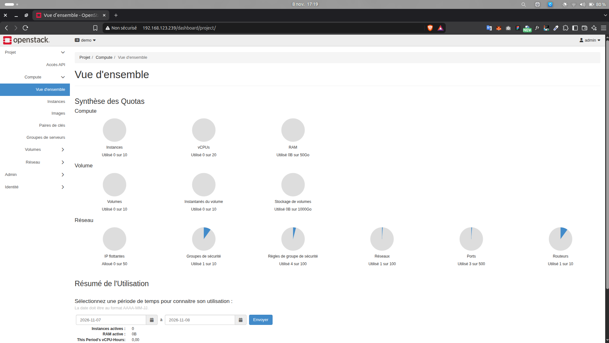
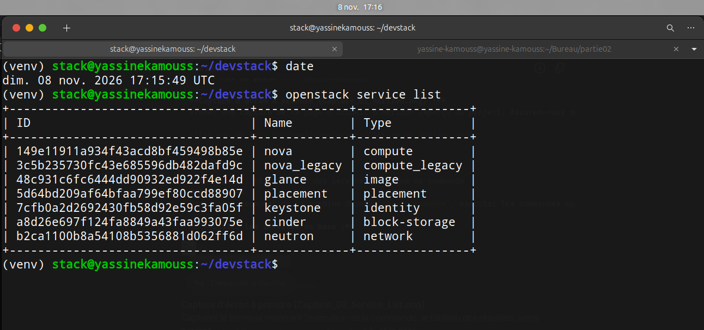
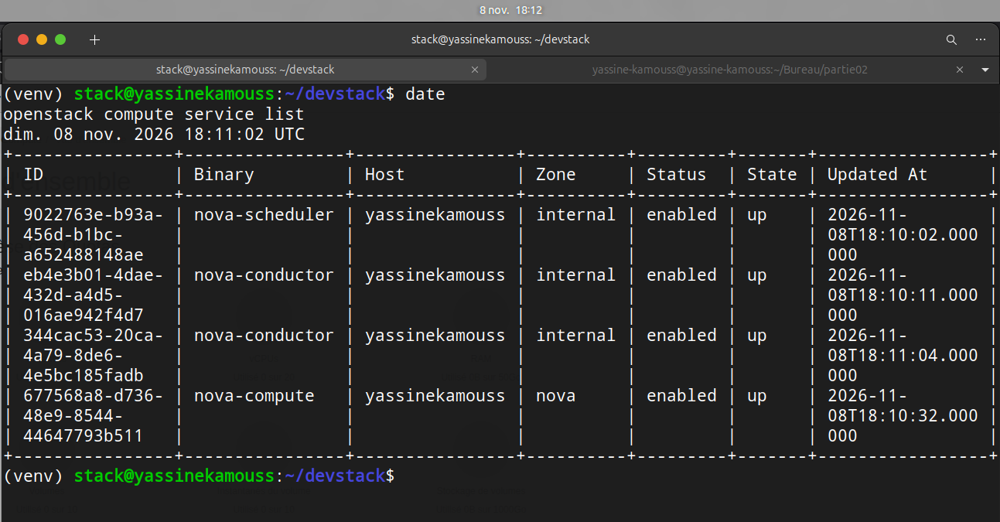
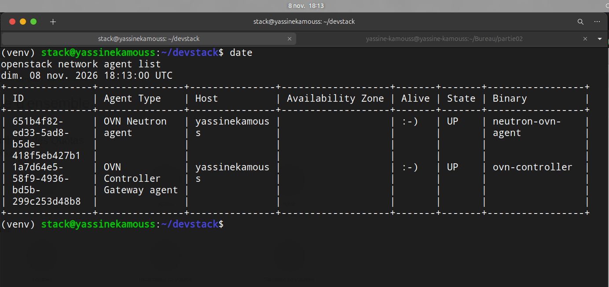

## Partie 2. OpenStack : IaaS et SaaS

### 1. Vérification de l'installation DevStack

Pour valider le bon déploiement de notre environnement Cloud basé sur OpenStack via DevStack, nous avons procédé à deux types de vérifications : l'accès à l'interface graphique et la vérification des services via l'interface en ligne de commande (CLI).

#### 1.1 Accès au tableau de bord Horizon

Nous avons vérifié l'accessibilité de l'interface graphique Horizon en nous connectant à l'adresse IP de notre hôte (`http://192.168.123.239/`) via un navigateur web. L'authentification a été réalisée avec succès en utilisant les identifiants par défaut de DevStack (utilisateur : `admin`).

**Capture d'écran 1 :** Tableau de bord Horizon (Aperçu du projet) connecté avec succès, montrant la date et le nom d'utilisateur.


#### 1.2 Vérification des services en ligne de commande

Après avoir chargé les variables d'environnement (`source openrc admin admin`), nous avons vérifié l'état des différents composants OpenStack pour nous assurer que l'architecture sous-jacente est pleinement opérationnelle.

**A. Liste des services globaux**
La commande suivante permet de lister tous les services OpenStack enregistrés :
```bash
date
openstack service list
```

**Capture d'écran 2 :** Exécution de `openstack service list` affichant les composants actifs.


**B. Liste des services de calcul (Compute)**
Pour vérifier l'état des services de calcul (Nova), nous avons exécuté :
```bash
date
openstack compute service list
```

**Capture d'écran 3 :** État des services de calcul (`nova-compute`, `nova-scheduler`, etc.).


**C. Liste des agents réseau**
La vérification de l'infrastructure réseau (Neutron) a été effectuée avec :
```bash
date
openstack network agent list
```

**Capture d'écran 4 :** Liste des agents réseau (DHCP, L3, Open vSwitch).


#### 1.3 Rôle des services OpenStack

Voici l'explication du rôle de chaque service clé listé dans notre architecture :

*   **Keystone :** C'est le service d'identité qui centralise l'authentification, l'autorisation et le catalogue de l'ensemble des services de l'infrastructure OpenStack.
*   **Nova :** C'est le service de calcul (Compute) qui gère la création, la planification et le cycle de vie complet des machines virtuelles.
*   **Glance :** C'est le service de registre d'images qui permet de stocker, de découvrir et de fournir les images des systèmes d'exploitation (comme Ubuntu ou CirrOS) utilisées pour instancier les machines virtuelles.
*   **Neutron :** C'est le service de réseau qui fournit la connectivité (réseaux virtuels, routeurs, IP flottantes, groupes de sécurité) entre les instances et avec les réseaux externes.
*   **Placement :** C'est l'API qui effectue le suivi et l'inventaire des ressources matérielles disponibles (CPU, RAM, stockage) pour aider Nova à attribuer le meilleur hôte lors de la création d'une instance.
*   **Cinder :** C'est le service de stockage par blocs qui fournit des volumes de stockage persistants pouvant être attachés et détachés dynamiquement aux instances de calcul.