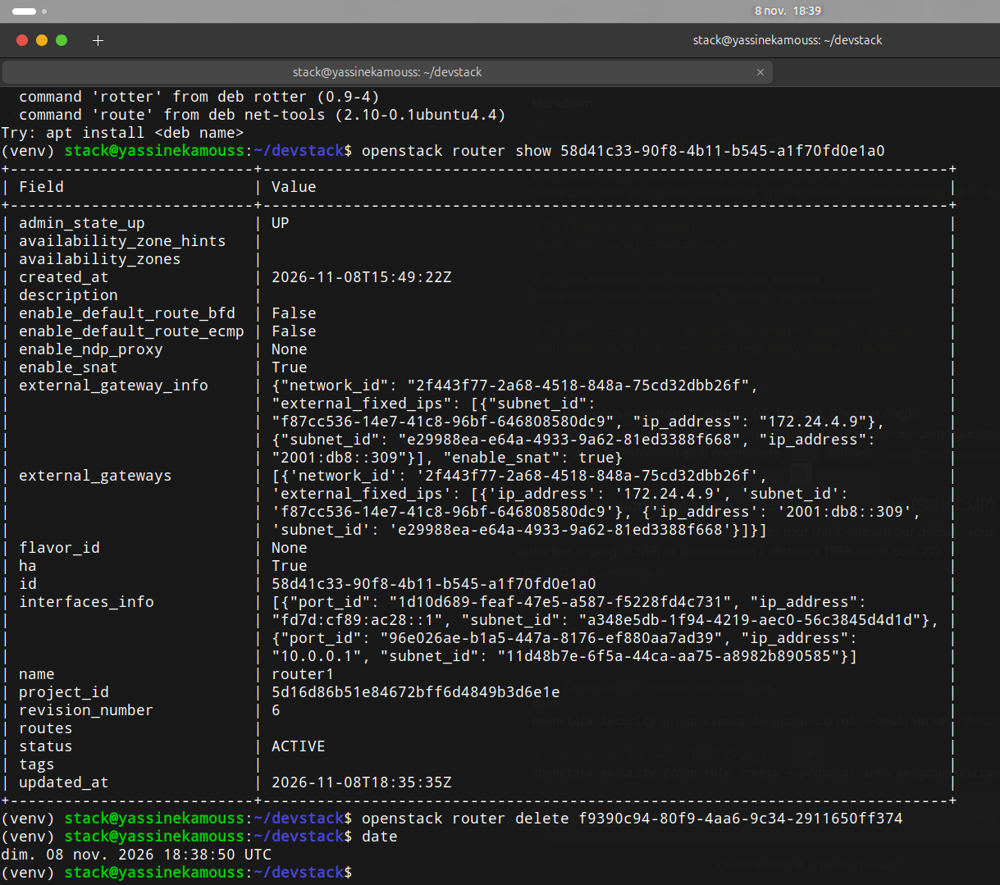
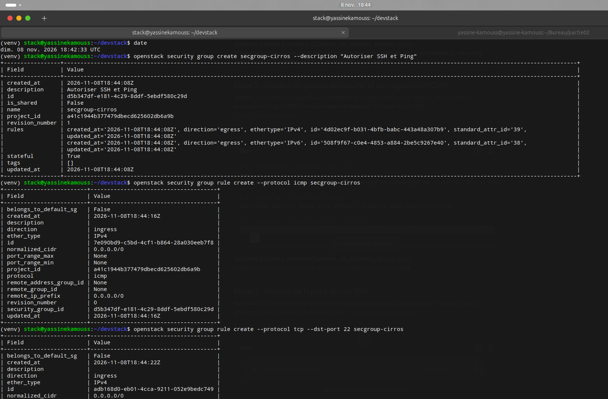
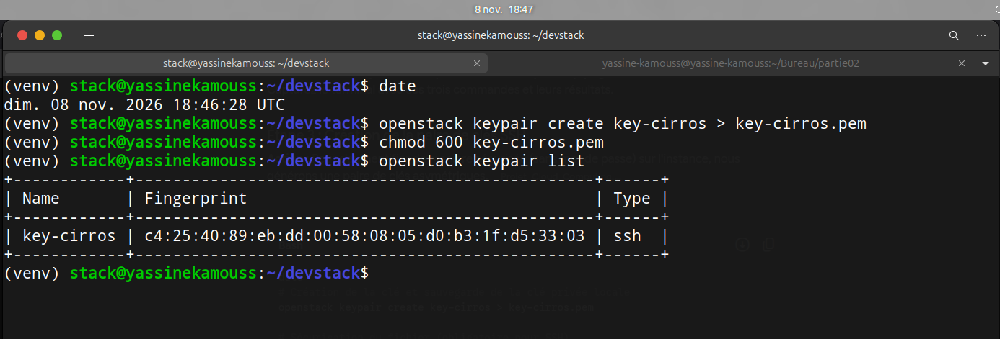
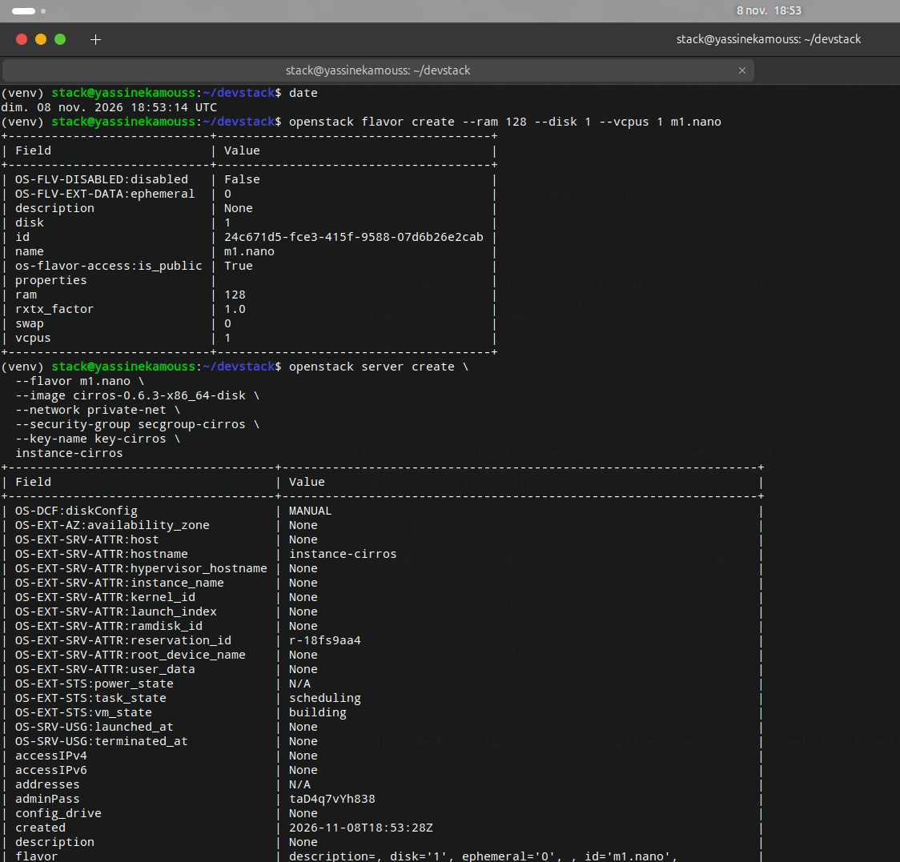
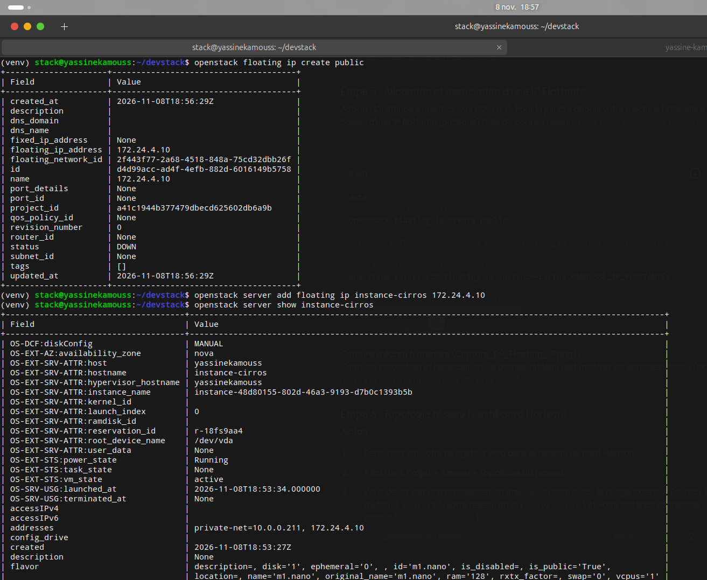
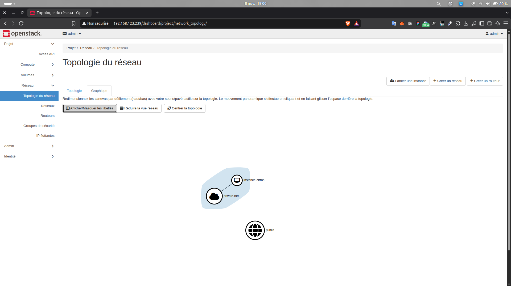
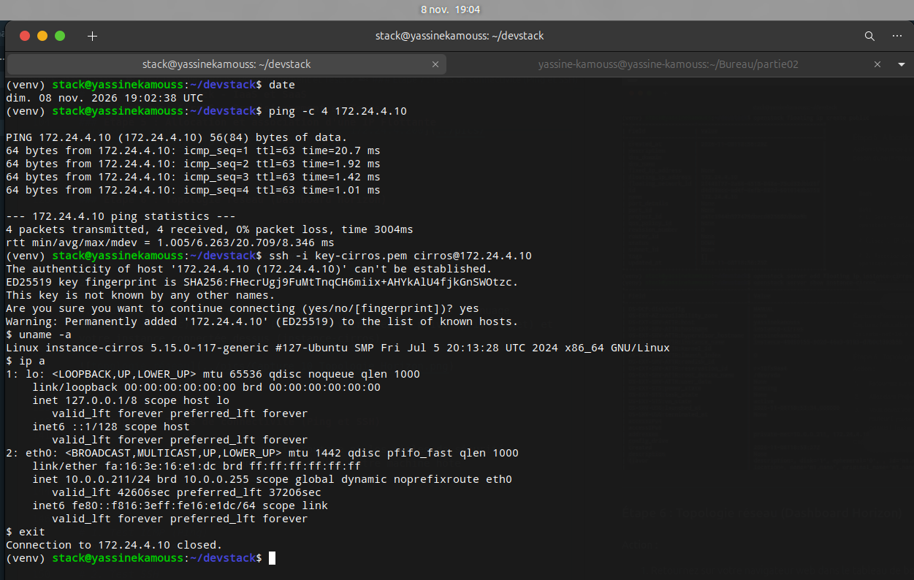

### 2. IaaS avec CirrOS : Provisionnement et Tests

Pour cette partie, nous avons adopté une approche d'Infrastructure as Code (IaC) via l'interface en ligne de commande (CLI) d'OpenStack. Cette méthode d'ingénieur garantit la reproductibilité des actions, contrairement aux clics manuels dans l'interface graphique.

#### 2.1 Création de l'infrastructure réseau (Réseau privé et Routeur)

Nous avons commencé par créer un réseau isolé, son sous-réseau associé, et un routeur pour assurer le routage vers l'extérieur (Internet). Pour éviter les conflits de noms récurrents dans les environnements DevStack (erreur de type `More than one Subnet/Router exists`), nous avons veillé à utiliser les identifiants uniques (UUIDs) pour l'attachement des ressources.

```bash
date
openstack network create private-net
openstack subnet create --network private-net --subnet-range 10.0.0.0/24 private-subnet
openstack router create router1

# Attachement du sous-réseau au routeur (via UUID pour éviter les conflits)
openstack router add subnet <UUID_ROUTER> <UUID_SUBNET>

# Définition de la passerelle externe
openstack router set --external-gateway public <UUID_ROUTER>
```



#### 2.2 Configuration de la sécurité (Groupe de sécurité et Paire de clés)

Par défaut, OpenStack bloque tout trafic entrant. Nous avons créé un groupe de sécurité dédié pour autoriser le ping et les connexions SSH. Ensuite, nous avons généré une paire de clés asymétriques pour une authentification sécurisée sans mot de passe.

```bash
date
# Groupe de sécurité
openstack security group create secgroup-cirros --description "Autoriser SSH et Ping"
openstack security group rule create --protocol icmp secgroup-cirros
openstack security group rule create --protocol tcp --dst-port 22 secgroup-cirros

# Paire de clés
openstack keypair create key-cirros > key-cirros.pem
chmod 600 key-cirros.pem
openstack keypair list
```




#### 2.3 Création du gabarit (Flavor) et Lancement de l'instance

L'image CirrOS (`cirros-0.6.3-x86_64-disk`) étant ultra-légère, nous avons d'abord provisionné un gabarit adapté (`m1.nano` avec 128 Mo de RAM) qui n'était pas présent par défaut. Nous avons ensuite lancé l'instance en y attachant tous les éléments réseaux et sécuritaires préalablement configurés.

```bash
# Création du gabarit adapté
openstack flavor create --ram 128 --disk 1 --vcpus 1 m1.nano

# Lancement de l'instance
date
openstack server create \
  --flavor m1.nano \
  --image cirros-0.6.3-x86_64-disk \
  --network private-net \
  --security-group secgroup-cirros \
  --key-name key-cirros \
  instance-cirros
```



#### 2.4 Allocation d'une IP flottante et Topologie réseau

Afin de rendre l'instance accessible depuis notre machine hôte, nous avons alloué une adresse IP publique (flottante) depuis le pool du réseau externe et l'avons associée à notre instance CirrOS.

```bash
date
openstack floating ip create public
openstack server add floating ip instance-cirros <ADRESSE_IP_FLOTTANTE>
openstack server show instance-cirros
```



Nous avons ensuite vérifié la cohérence de notre déploiement depuis le tableau de bord Horizon.



#### 2.5 Tests de connectivité

Pour valider définitivement le succès du déploiement IaaS, nous avons testé la connectivité depuis la machine hôte vers l'IP flottante de l'instance, d'abord via le protocole ICMP (Ping), puis via une connexion sécurisée SSH.

```bash
date
# Test du routage
ping -c 4 <ADRESSE_IP_FLOTTANTE>

# Test de l'accès distant
ssh -i key-cirros.pem cirros@<ADRESSE_IP_FLOTTANTE>
uname -a
ip a
exit
```

