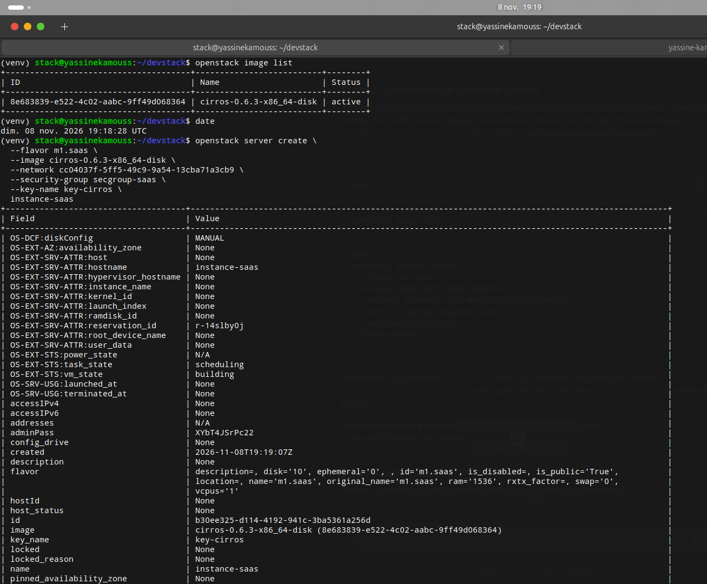
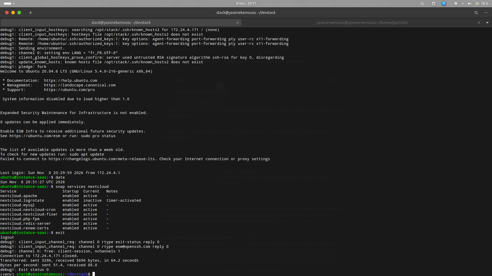

### 3. Déploiement SaaS avec Ubuntu Server (Nextcloud)

Pour cette dernière étape de la Partie 2, l'objectif est de déployer une solution SaaS (Software as a Service) complète. Nous avons choisi **Nextcloud**, une plateforme de collaboration et de stockage de type Cloud privé, installée via le gestionnaire de paquets `snap` sur une instance Ubuntu.

#### 3.1 Optimisation des ressources et Création du gabarit

Conformément aux bonnes pratiques d'ingénierie Cloud, nous avons d'abord libéré des ressources sur notre environnement DevStack (limité en mémoire) en arrêtant l'instance CirrOS. Ensuite, nous avons créé un gabarit (flavor) sur mesure nommé `m1.saas` adapté aux prérequis de Nextcloud (1,5 Go de RAM).

```bash
date
openstack server stop instance-cirros
openstack server list
openstack flavor create --ram 1536 --disk 10 --vcpus 1 m1.saas
```


#### 3.2 Configuration de la sécurité pour le Web

Pour rendre notre application accessible, nous avons créé un nouveau groupe de sécurité autorisant le trafic HTTP (port 80), ainsi que le SSH (port 22) et l'ICMP (Ping) pour l'administration et le diagnostic réseau.

```bash
date
openstack security group create secgroup-saas --description "Autoriser Web, SSH et Ping"
openstack security group rule create --protocol tcp --dst-port 22 secgroup-saas
openstack security group rule create --protocol tcp --dst-port 80 secgroup-saas
openstack security group rule create --protocol icmp secgroup-saas
```


#### 3.3 Importation de l'image Ubuntu et Lancement de l'instance

L'environnement DevStack par défaut ne contenant que l'image CirrOS, nous avons procédé au téléchargement de l'image officielle Cloud d'Ubuntu 20.04 LTS (Focal Fossa) pour garantir la stabilité du réseau, puis nous l'avons importée dans le service Glance.

```bash
# Téléchargement et import de l'image
wget https://cloud-images.ubuntu.com/focal/current/focal-server-cloudimg-amd64.img
openstack image create "ubuntu-20.04" --file focal-server-cloudimg-amd64.img --disk-format qcow2 --container-format bare --public

# Lancement de l'instance SaaS
date
openstack server create \
  --flavor m1.saas \
  --image ubuntu-20.04 \
  --network <ID_DU_RESEAU_PRIVATE_NET> \
  --security-group secgroup-saas \
  --key-name key-cirros \
  instance-saas
```



#### 3.4 Allocation réseau et Dépannage (Troubleshooting)

Nous avons assigné une IP flottante (`172.24.4.171`) à l'instance. Lors de la connexion SSH, nous avons appliqué des correctifs d'ingénierie essentiels pour stabiliser la machine :

1. **Nettoyage de l'empreinte SSH** (`ssh-keygen -R 172.24.4.171`) suite au changement de système d'exploitation sur la même adresse IP.
2. **Correction de la résolution DNS interne** : Le serveur DNS de DevStack étant instable pour Snapcraft, nous avons forcé l'utilisation du DNS de Google (`8.8.8.8`) dans `/etc/resolv.conf`.
3. **Correction du nom d'hôte local** : Ajout de `127.0.0.1 instance-saas` dans `/etc/hosts` pour optimiser l'exécution des commandes `sudo`.

#### 3.5 Installation de l'application SaaS (Nextcloud)

Une fois l'environnement parfaitement sain, nous nous sommes connectés en SSH pour lancer le déploiement automatisé de Nextcloud.

```bash
date
ssh -i key-cirros.pem ubuntu@172.24.4.171
sudo snap install nextcloud
snap services nextcloud
```




#### 3.6 Validation finale via le Navigateur

Pour valider le service SaaS, nous avons accédé à l'adresse IP flottante depuis un navigateur web. Le serveur web Apache configuré par Snap a répondu avec succès en affichant l'interface d'initialisation de Nextcloud.

**Capture d'écran 16 :** Navigateur web ouvert sur la page d'accueil de Nextcloud, montrant l'URL `http://172.24.4.171` et l'horloge système, confirmant l'accessibilité de l'application depuis l'extérieur (`Capture_16_Navigateur_SaaS.png`).

