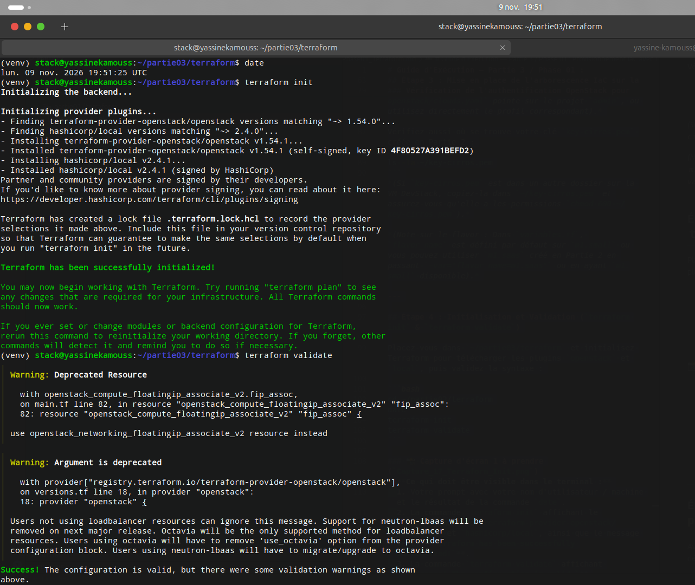
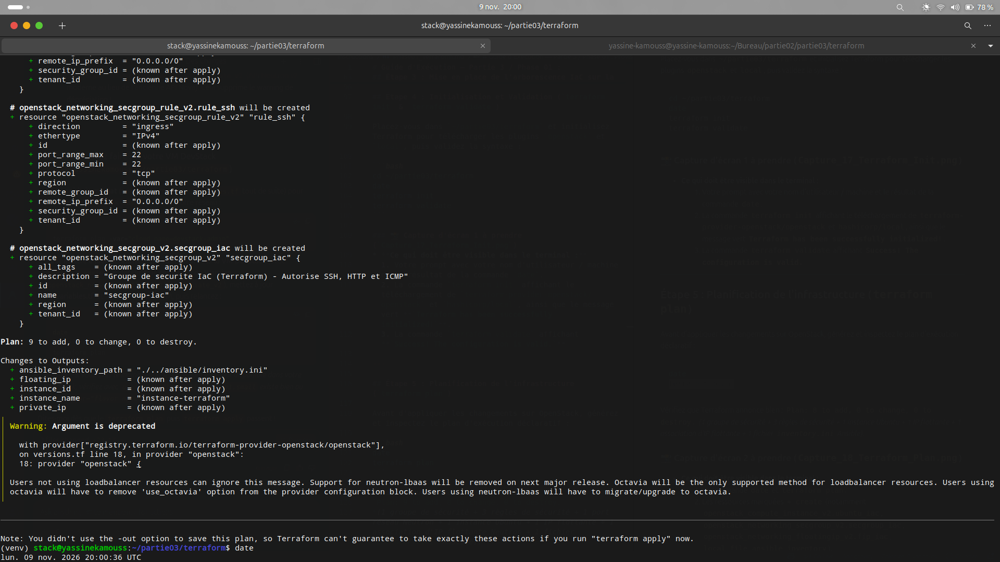
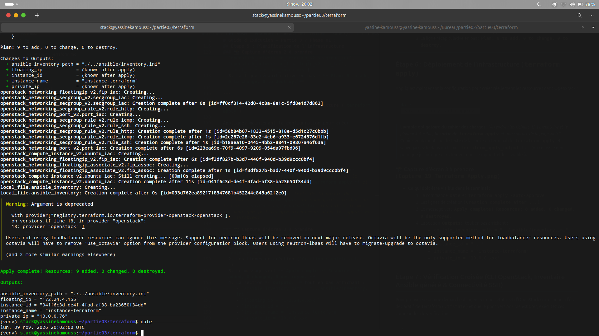
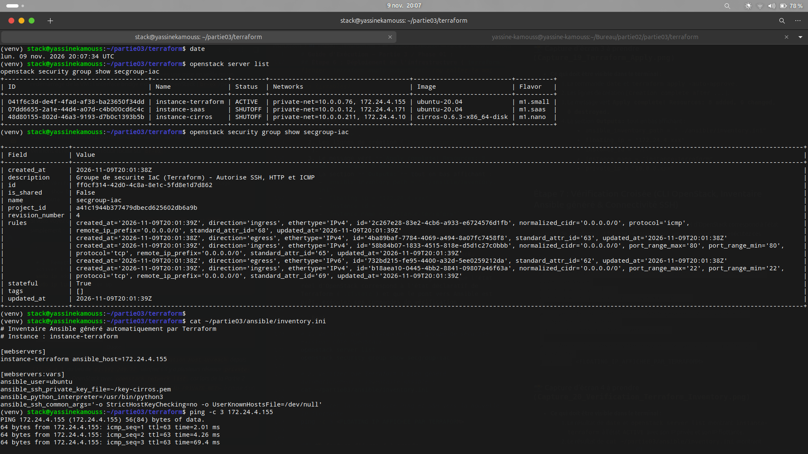

## Partie 3. Infrastructure as Code : Terraform et Ansible

### 1. Provisionnement Déclaratif de l'Infrastructure avec Terraform

Dans la continuité de la Partie 2 où nous utilisions l'interface en ligne de commande (CLI) de manière impérative, cette troisième partie introduit une véritable démarche d'**Infrastructure as Code (IaC)** déclarative avec **Terraform** (`terraform-provider-openstack`). L'objectif est de décrire l'état cible de notre infrastructure dans des fichiers de configuration versionnés (`.tf`), d'automatiser le cycle de vie complet des ressources (groupe de sécurité, port réseau, instance Ubuntu Server, IP flottante) et de générer dynamiquement l'inventaire pour **Ansible** sans aucune intervention ni saisie manuelle.

---

#### 1.1 Architecture modulaire des fichiers Terraform et Bonnes Pratiques

Conformément aux standards d'ingénierie DevOps, nous avons structuré notre code Terraform dans le répertoire `partie03/terraform/` en séparant les responsabilités :

*   **`versions.tf` (Fournisseurs et Authentification sécurisée) :** Déclare les providers `terraform-provider-openstack/openstack` (`~> 1.54.0`) et `hashicorp/local` (`~> 2.4.0`). Conformément aux bonnes pratiques de sécurité (*Zero Hardcoded Secrets*), aucun mot de passe n'est inscrit dans le code : Terraform s'authentifie directement via le profil `devstack-admin` du fichier `/etc/openstack/clouds.yaml`.
*   **`variables.tf` (Paramétrage) :** Externalise les paramètres de déploiement (`instance-terraform`, image `ubuntu-20.04`, gabarit `m1.small`, réseau privé `private-net`, pool externe `public`, paire de clés `key-cirros`).
*   **`main.tf` (Définition déclarative des ressources) :**
    1.  **Source de données (`data.openstack_networking_network_v2`) :** Interroge l'API Neutron pour récupérer dynamiquement l'UUID du réseau `private-net` créé en Partie 2 (`cc04037f-5ff5-49c9-9a54-13cba71a3cb9`).
    2.  **Groupe de sécurité (`openstack_networking_secgroup_v2` & règles) :** Crée le groupe `secgroup-iac` et ses 3 règles entrantes (Ingress IPv4) autorisant **SSH (TCP/22)**, **HTTP (TCP/80)** et **ICMP (Ping)**.
    3.  **Port réseau et Instance Ubuntu (`openstack_networking_port_v2` & `openstack_compute_instance_v2`) :** Crée un port réseau dédié rattaché au groupe de sécurité `secgroup-iac` et déploie l'instance `instance-terraform` avec un script `cloud-init` (`user_data`) qui configure proactivement le DNS (`8.8.8.8`) et `/etc/hosts` dès le premier démarrage.
    4.  **IP Flottante (`openstack_networking_floatingip_v2` & `openstack_networking_floatingip_associate_v2`) :** Alloue une IP publique depuis le pool `public` et l'associe au port Neutron de l'instance.
    5.  **Pont IaC vers Ansible (`local_file.ansible_inventory`) :** Utilise le modèle `inventory.tftpl` pour générer automatiquement le fichier `../ansible/inventory.ini` contenant l'adresse IP flottante fraîchement attribuée.
*   **`outputs.tf` (Sorties d'exécution) :** Expose les attributs essentiels après le déploiement (`instance_name`, `instance_id`, `private_ip`, `floating_ip`, `ansible_inventory_path`).

---

#### 1.2 Initialisation et Validation (`terraform init` & `terraform validate`)

La première étape du cycle de vie Terraform consiste à initialiser le répertoire de travail pour télécharger les plugins nécessaires et créer le fichier de verrouillage `.terraform.lock.hcl`, puis à vérifier la validité syntaxique et sémantique de la configuration.

```bash
date
terraform init
terraform validate
```

**Capture d'écran 17 :** Exécution de `terraform init` et `terraform validate` confirmant le téléchargement des providers `openstack` et `local` ainsi que la validité de la configuration.


---

#### 1.3 Résolution de problèmes d'ingénierie (Troubleshooting avant déploiement)

Au cours des phases de validation (`terraform validate`) et de planification initiale (`terraform plan`), nous avons identifié et résolu deux problèmes techniques :

1.  **Isolation multi-projets dans `clouds.yaml` (`Error: Your query returned no results` sur `private-net`) :**
    *   *Diagnostic :* Par défaut, le profil `devstack` dans `/etc/openstack/clouds.yaml` s'authentifie sur le projet `demo`, alors que l'infrastructure de la Partie 2 (`private-net`, `key-cirros`, `ubuntu-20.04`) avait été créée dans le projet `admin`.
    *   *Correction :* Configuration de la variable `cloud_name = "devstack-admin"` dans `variables.tf` afin d'aligner Terraform sur le tenant `admin`.
2.  **Dépréciation de la ressource Nova d'association d'IP flottante (`Warning: Deprecated Resource openstack_compute_floatingip_associate_v2`) :**
    *   *Diagnostic :* L'association d'IP flottante via l'API Compute (Nova) est dépréciée au profit de l'API Networking (Neutron).
    *   *Correction :* Remplacement par un port Neutron explicite (`openstack_networking_port_v2.port_iac`) et utilisation de la ressource moderne `openstack_networking_floatingip_associate_v2` reliée au `port_id`.

---

#### 1.4 Planification de l'infrastructure (`terraform plan`)

Une fois ces ajustements appliqués, nous avons généré le plan d'exécution spéculatif permettant de vérifier les 9 ressources à créer avant toute modification réelle sur OpenStack :

```bash
date
terraform plan
```

**Capture d'écran 18 :** Résultat de `terraform plan` annonçant la création de 9 ressources (`Plan: 9 to add, 0 to change, 0 to destroy`).


---

#### 1.5 Déploiement automatisé (`terraform apply`)

Nous avons ensuite exécuté le provisionnement effectif de l'infrastructure :

```bash
date
terraform apply -auto-approve
```

**Extrait des sorties (`Outputs`) générées par `terraform apply` :**
```text
Apply complete! Resources: 9 added, 0 changed, 0 destroyed.

Outputs:

ansible_inventory_path = "./../ansible/inventory.ini"
floating_ip = "172.24.4.155"
instance_id = "041f6c3d-de4f-4fad-af38-ba23650f34dd"
instance_name = "instance-terraform"
private_ip = "10.0.0.76"
```

**Capture d'écran 19 :** Exécution complète de `terraform apply` affichant la création des 9 ressources et les variables de sortie (`floating_ip = "172.24.4.155"`, `private_ip = "10.0.0.76"`).


---

#### 1.6 Vérification croisée, Routage `br-ex` et Validation de l'inventaire Ansible

Pour valider le déploiement de bout en bout, nous avons contrôlé l'état des ressources via la CLI OpenStack, vérifié le fichier `inventory.ini` généré automatiquement pour Ansible, et testé la connectivité ICMP :

1.  **Diagnostic et correction du routage externe (`br-ex`) :** Lors du premier test `ping 172.24.4.155`, les paquets partaient vers la passerelle Internet par défaut (`Time to live exceeded`) car l'interface pont externe d'Open vSwitch (`br-ex`) avait perdu son adresse passerelle locale. Nous avons rétabli la route locale sur la VM DevStack :
    ```bash
    sudo ip addr add 172.24.4.1/24 dev br-ex 2>/dev/null || true
    sudo ip link set br-ex up
    ```
2.  **Vérification finale des ressources, de l'inventaire et de la connectivité :**
    ```bash
    date
    openstack server list
    openstack security group show secgroup-iac
    cat ~/partie03/ansible/inventory.ini
    ping -c 3 172.24.4.155
    ```

**Capture d'écran 20 :** Vérification de l'instance `instance-terraform` (`ACTIVE`), des règles du groupe `secgroup-iac`, du fichier `inventory.ini` auto-généré par Terraform et réussite du test `ping -c 3 172.24.4.155` (0% de perte).

