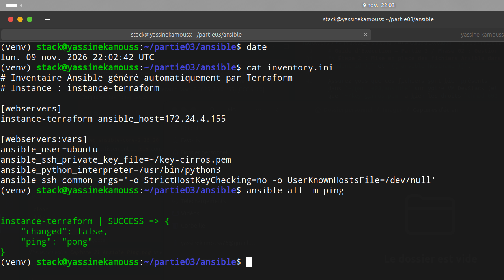
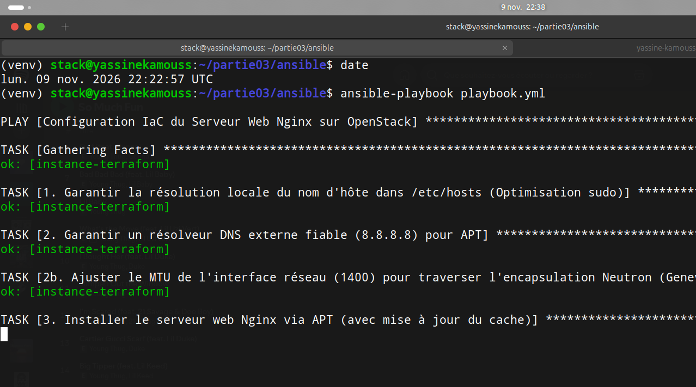
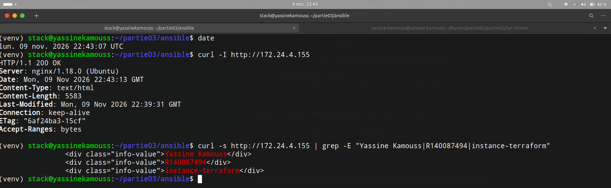
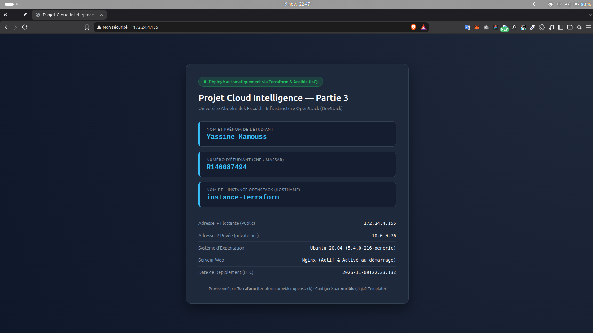
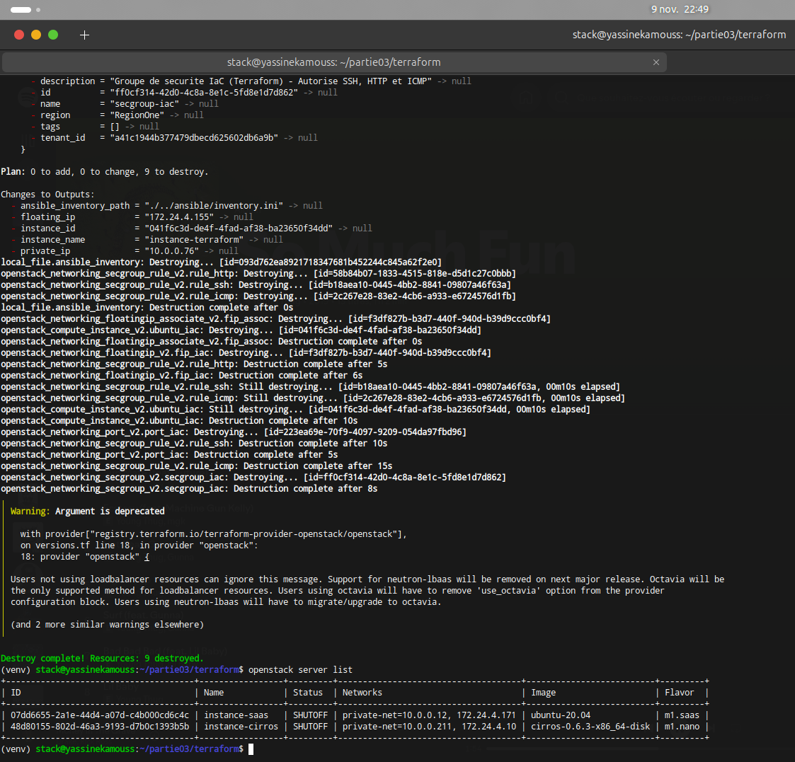

### 2. Gestion de Configuration Automatisée avec Ansible (Déploiement Web Nginx)

Une fois l'infrastructure IaaS provisionnée par Terraform (`instance-terraform`, groupe de sécurité `secgroup-iac` et IP flottante `172.24.4.155`), nous avons utilisé **Ansible** pour assurer la gestion de configuration (*Configuration Management*) du système d'exploitation et le déploiement applicatif.

Conformément à notre approche d'ingénierie DevOps, cette phase repose sur trois piliers :
1. **Zéro intervention manuelle (Continuité IaC) :** Utilisation directe du fichier `inventory.ini` généré dynamiquement par Terraform lors du `terraform apply`.
2. **Idempotence :** Emploi exclusif des modules déclaratifs natifs (`ansible.builtin.apt`, `ansible.builtin.service`, `ansible.builtin.template`, `ansible.builtin.lineinfile`) garantissant que l'exécution répétée du playbook converge toujours vers le même état cible sans effet de bord.
3. **Templating dynamique (Jinja2) :** Génération de la page web via un modèle `index.html.j2` qui injecte automatiquement les variables de l'étudiant ainsi que les *Ansible Facts* collectés en temps réel sur la machine virtuelle (`{{ ansible_hostname }}`, `{{ ansible_default_ipv4.address }}`, `{{ ansible_distribution }}`).

---

#### 2.1 Architecture des fichiers Ansible (`partie03/ansible/`)

Le projet Ansible est structuré autour de quatre fichiers :

*   **`ansible.cfg` :** Configure le comportement du moteur Ansible (inventaire par défaut `./inventory.ini`, utilisateur distant `ubuntu`, désactivation du `host_key_checking` pour les IP flottantes éphémères, et activation du `pipelining` SSH pour optimiser les performances).
*   **`inventory.ini` (Généré automatiquement par Terraform) :**
    ```ini
    # Inventaire Ansible généré automatiquement par Terraform
    # Instance : instance-terraform

    [webservers]
    instance-terraform ansible_host=172.24.4.155

    [webservers:vars]
    ansible_user=ubuntu
    ansible_ssh_private_key_file=~/key-cirros.pem
    ansible_python_interpreter=/usr/bin/python3
    ansible_ssh_common_args='-o StrictHostKeyChecking=no -o UserKnownHostsFile=/dev/null'
    ```
*   **`playbook.yml` :** Décrit les pré-tâches de stabilisation réseau (`/etc/hosts`, DNS `8.8.8.8`, ajustement du MTU à `1400` pour les tunnels Neutron Geneve/VXLAN), l'installation du paquet `nginx`, le démarrage et l'activation du service au boot (`enabled: true`), le déploiement du template Jinja2 et le *handler* événementiel `Reload Nginx`.
*   **`templates/index.html.j2` :** Modèle HTML5/CSS3 injectant dynamiquement :
    *   **Nom et Prénom :** `{{ student_name }}` (`Yassine Kamouss`)
    *   **Numéro d'Étudiant :** `{{ student_id }}` (`R140087494`)
    *   **Nom de l'Instance OpenStack :** `{{ ansible_hostname }}` (`instance-terraform`)

---

#### 2.2 Résolution de problèmes d'ingénierie (Troubleshooting Ansible & Réseau)

Lors de la mise en œuvre, nous avons diagnostiqué et résolu quatre défis techniques :

1.  **Emplacement et permissions de la clé privée SSH (`key-cirros.pem`) :**
    *   *Symptôme :* Erreur `no such identity: /opt/stack/key-cirros.pem`.
    *   *Résolution :* Copie de la clé privée dans le répertoire personnel de l'utilisateur `stack` (`~/key-cirros.pem`) avec restriction stricte des permissions (`chmod 600 ~/key-cirros.pem`).
2.  **Matrice de compatibilité Python entre `ansible-core` et Ubuntu 20.04 LTS :**
    *   *Symptôme :* `Ansible requires Python 3.9 or newer on the target. Current version: 3.8.10`. L'environnement virtuel de la VM DevStack (Python 3.12) avait installé `ansible-core 2.21`, qui ne supporte plus Python 3.8 embarqué par défaut sur Ubuntu 20.04 LTS.
    *   *Résolution :* Alignement de la version du contrôleur Ansible sur la branche LTS compatible avec Python 3.8 :
        ```bash
        pip install "ansible-core<2.17"
        ```
3.  **Connectivité sortante APT (NAT `MASQUERADE` et MTU Neutron) :**
    *   *Symptôme :* Échec initial de `apt update` (`Failed to update apt cache`), suivi d'une attente liée au verrou APT détenu par `unattended-upgrades` au premier démarrage de l'image Cloud Ubuntu.
    *   *Résolution :* Activation du routage IPv4 et de la règle NAT `MASQUERADE` sur la VM DevStack vers l'interface externe, ajout d'une pré-tâche Ansible fixant le MTU de l'interface `ens3` à `1400` octets pour éviter la fragmentation dans les tunnels Neutron, et libération automatique du verrou APT par `unattended-upgrades`.
4.  **Routage entre la machine physique hôte et le réseau externe OpenStack (`172.24.4.0/24`) :**
    *   *Symptôme :* Le navigateur de la machine hôte affichait `ERR_ADDRESS_UNREACHABLE` en accédant à `http://172.24.4.155`.
    *   *Résolution :* Autorisation du transfert de paquets (`FORWARD` dans `iptables`) sur la VM DevStack et ajout d'une route statique sur la machine hôte pointant vers la VM DevStack (`192.168.123.239`) :
        ```bash
        # Sur la machine hôte :
        sudo ip route replace 172.24.4.0/24 via 192.168.123.239
        ```

---

#### 2.3 Validation de la connectivité Ansible (`ansible all -m ping`)

Avant d'exécuter le playbook, nous avons vérifié la communication SSH et le bon fonctionnement de l'interpréteur Python distant à l'aide du module `ping` :

```bash
date
cat inventory.ini
ansible all -m ping
```

**Capture d'écran 21 :** Vérification de l'inventaire auto-généré et succès du test `ansible all -m ping` (`"ping": "pong"`).


---

#### 2.4 Exécution du Playbook Ansible (`ansible-playbook playbook.yml`)

Nous avons ensuite lancé le playbook pour configurer l'instance, installer et activer Nginx, et déployer la page web personnalisée :

```bash
date
ansible-playbook playbook.yml
```

Le récapitulatif d'exécution (`PLAY RECAP`) confirme l'application complète des tâches sans aucune erreur :
```text
PLAY RECAP ****************************************************************************************************************************************
instance-terraform         : ok=8    changed=3    unreachable=0    failed=0    skipped=0    rescued=0    ignored=0
```

**Capture d'écran 22 :** Exécution du playbook Ansible `playbook.yml` sur l'instance `instance-terraform`.


---

#### 2.5 Vérification HTTP en ligne de commande (`curl`) et dans le Navigateur Web

Pour valider le service web, nous avons d'abord inspecté les en-têtes HTTP et le code source servi par Nginx en ligne de commande :

```bash
date
curl -I http://172.24.4.155
curl -s http://172.24.4.155 | grep -E "Yassine Kamouss|R140087494|instance-terraform"
```

**Capture d'écran 23 :** Vérification CLI avec `curl` confirmant le code `HTTP/1.1 200 OK`, le serveur `nginx/1.18.0 (Ubuntu)` et la présence des trois informations requises dans le DOM HTML.


Nous avons ensuite ouvert l'adresse `http://172.24.4.155` dans le navigateur web pour valider le rendu visuel de la page déployée par Ansible.

**Capture d'écran 24 :** Page web servie par Nginx sur `http://172.24.4.155`, affichant le nom de l'étudiant (**Yassine Kamouss**), le numéro d'étudiant (**R140087494**), le nom de l'instance (**`instance-terraform`**) ainsi que la date et les métadonnées techniques de l'instance.


---

#### 2.6 Clôture du cycle de vie IaC : Destruction de l'infrastructure (`terraform destroy`)

Conformément aux exigences de la Question 1 du cahier des charges (*"Utiliser `terraform init`, `plan`, `apply`, puis `destroy` à la fin"*), une fois le déploiement Ansible validé et documenté, nous avons procédé au déprovisionnement propre et complet des 9 ressources via Terraform :

```bash
cd ~/partie03/terraform
date
terraform destroy -auto-approve
openstack server list
```

**Capture d'écran 25 :** Exécution de `terraform destroy -auto-approve` confirmant la suppression des 9 ressources (`Destroy complete! Resources: 9 destroyed.`) et vérification via `openstack server list` que `instance-terraform` a bien été supprimée.

