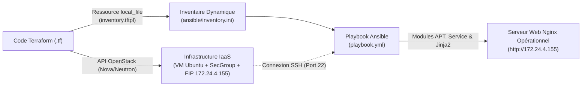

### 3. Analyse Comparative d'Ingénierie : Provisionnement d'Infrastructure (Terraform) vs Gestion de Configuration (Ansible)

Dans une architecture Cloud moderne fondée sur l'**Infrastructure as Code (IaC)**, **Terraform** et **Ansible** ne sont pas des outils concurrents mais **complémentaires**. Ils interviennent à deux couches distinctes du modèle de responsabilité Cloud et répondent à deux problématiques d'ingénierie différentes : le **provisionnement de l'infrastructure (Couche IaaS)** et la **gestion de configuration (Couche OS & Applicative)**.

---

#### 3.1 Différence fondamentale de rôle et de couche d'abstraction

1.  **Terraform — L'Orchestrateur de Provisionnement d'Infrastructure (*Infrastructure Provisioning*) :**
    *   **Rôle :** Créer, modifier et détruire le cycle de vie des ressources d'infrastructure virtuelles (réseaux, sous-réseaux, routeurs, groupes de sécurité, ports Neutron, volumes Cinder, instances de calcul Nova, adresses IP flottantes).
    *   **Mode d'interaction :** Il dialogue exclusivement avec les **API du fournisseur Cloud** (dans notre cas, les API REST d'OpenStack : Keystone, Nova, Neutron, Glance) via le plugin `terraform-provider-openstack`. Il n'a pas besoin de se connecter en SSH à l'intérieur des machines.
    *   **Exemple dans notre projet :** C'est Terraform qui a instancié `instance-terraform`, ouvert les ports 22 et 80 dans `secgroup-iac` et associé l'IP flottante `172.24.4.155`.

2.  **Ansible — Le Gestionnaire de Configuration (*Configuration Management*) :**
    *   **Rôle :** Configurer le système d'exploitation, installer les paquets logiciels, gérer les services système (`systemd`), appliquer les politiques de sécurité internes et déployer le code applicatif **à l'intérieur** d'une machine déjà existante.
    *   **Mode d'interaction :** Architecture **sans agent (*Agentless*)** qui se connecte directement au système d'exploitation cible via **SSH** et exécute des modules Python distants.
    *   **Exemple dans notre projet :** C'est Ansible qui s'est connecté en SSH à `172.24.4.155`, a configuré `/etc/hosts` et le DNS, a installé le paquet `nginx`, a démarré le service et a généré la page `/var/www/html/index.html` via le moteur de templates Jinja2.

---

#### 3.2 Tableau comparatif multicritère (Approche Ingénieur DevOps)

| Critère d'Ingénierie | Terraform (HashiCorp) | Ansible (Red Hat) |
| :--- | :--- | :--- |
| **Catégorie principale** | Provisionnement d'infrastructure (*IaaS Provisioning*) | Gestion de configuration (*Configuration Management*) |
| **Paradigme du langage** | **Purement déclaratif** (HCL — *HashiCorp Configuration Language*) : on décrit l'état final souhaité, Terraform calcule seul le graphe de dépendances (DAG). | **Hybride (Procédural / Déclaratif)** en YAML : les tâches s'exécutent séquentiellement dans l'ordre du Playbook, mais chaque module est déclaratif et idempotent. |
| **Gestion de l'état (*State*)** | **Stateful (Avec état) :** Maintient un fichier d'état (`terraform.tfstate`) qui cartographie les ressources déclarées avec leurs UUID réels dans OpenStack. | **Stateless (Sans fichier d'état persistant) :** Inspecte l'état réel de la machine cible en direct via SSH (*Gathering Facts*) à chaque exécution. |
| **Philosophie de cycle de vie** | **Infrastructure Immuable :** Si une propriété structurelle change (ex: changement d'image OS ou de `user_data`), Terraform détruit l'instance et en recrée une neuve. | **Infrastructure Mutable :** Modifie et met à jour les fichiers et services sur place (*in-place*) sur le serveur existant. |
| **Protocole de communication** | Appels **API HTTP/HTTPS** vers le contrôleur Cloud (Keystone, Nova, Neutron). | Connexion **SSH** directe vers le système d'exploitation des instances. |
| **Gestion de la suppression** | Native et automatique (`terraform destroy` supprime tout ce qui est tracé dans le `.tfstate`). | Manuelle (nécessite d'écrire explicitement une tâche inverse avec `state: absent`). |

---

#### 3.3 Synergie et Chaîne d'Automatisation Continue (Notre implémentation)

Plutôt que d'utiliser un seul outil hors de son domaine d'excellence (par exemple, utiliser des scripts `remote-exec` fragiles dans Terraform ou provisionner toute l'infrastructure avec Ansible sans fichier d'état `.tfstate`), les meilleures pratiques d'ingénierie préconisent de **chaîner Terraform et Ansible** :

**Synthèse :**
* **Terraform** construit les murs et l'électricité du bâtiment (le serveur virtuel, sa carte réseau, son pare-feu OpenStack et son adresse IP publique) et transmet automatiquement les clés (le fichier `inventory.ini`) à **Ansible**.
* **Ansible** aménage l'intérieur du bâtiment (optimisation d'Ubuntu, installation et activation de Nginx, et déploiement dynamique de l'application web).
