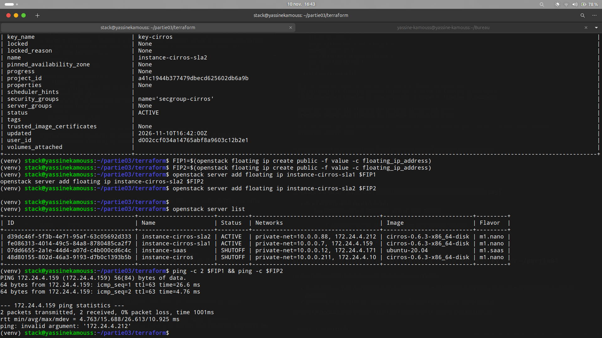

## Partie 4. Service Level Agreement (SLA) et Ingénierie de la Fiabilité (SRE)

### 1. Rédaction du Contrat SLA (`sla.json`) et Dimensionnement Mathématique de la Disponibilité

Un **Service Level Agreement (SLA)** est un contrat formel qui lie le fournisseur d'infrastructure Cloud (IaaS) et ses utilisateurs. Dans une approche d'**Ingénierie de la Fiabilité des Systèmes (SRE — *Site Reliability Engineering*)**, un SLA repose sur des **SLI (*Service Level Indicators*)** — les métriques objectives mesurées sur le système — et des **SLO (*Service Level Objectives*)** — les seuils chiffrés que ces indicateurs doivent respecter sous peine de pénalités contractuelles.

---

#### 1.1 Préparation du banc d'essai dédié (`instance-cirros-sla1` et `instance-cirros-sla2`)

Afin d'évaluer rigoureusement notre contrat SLA sans altérer les instances créées lors de la Partie 2 (`instance-cirros` et `instance-saas`, maintenues à l'état `SHUTOFF`), nous avons provisionné deux nouvelles instances légères basées sur CirrOS (`m1.nano`, 128 Mo de RAM) dotées chacune d'une adresse IP flottante :

*   **`instance-cirros-sla1` (`10.0.0.7` / IP flottante `172.24.4.159`) :** Instance témoin représentant un service en haute disponibilité nominale (sans interruption).
*   **`instance-cirros-sla2` (`10.0.0.88` / IP flottante `172.24.4.212`) :** Instance cible destinée aux tests de résilience et à l'injection de panne (*Chaos Engineering*).

```bash
NET_ID=$(openstack network show private-net -f value -c id)

openstack server create --flavor m1.nano --image cirros-0.6.3-x86_64-disk \
  --network $NET_ID --security-group secgroup-cirros --key-name key-cirros --wait instance-cirros-sla1

openstack server create --flavor m1.nano --image cirros-0.6.3-x86_64-disk \
  --network $NET_ID --security-group secgroup-cirros --key-name key-cirros --wait instance-cirros-sla2

FIP1=$(openstack floating ip create public -f value -c floating_ip_address)
FIP2=$(openstack floating ip create public -f value -c floating_ip_address)
openstack server add floating ip instance-cirros-sla1 $FIP1
openstack server add floating ip instance-cirros-sla2 $FIP2
openstack server list
```

**Capture d'écran 26 :** Provisionnement des deux instances dédiées `instance-cirros-sla1` (`172.24.4.159`) et `instance-cirros-sla2` (`172.24.4.212`) à l'état `ACTIVE`, tandis que `instance-cirros` et `instance-saas` restent intactes (`SHUTOFF`).


---

#### 1.2 Structure et clauses d'ingénierie du contrat `sla.json`

Nous avons choisi le format **JSON (`partie04/sla.json`)** afin que le contrat soit à la fois lisible par l'humain et directement exploitable par notre démon de surveillance automatisé en Python. Le contrat formalise les cinq clauses exigées par le cahier des charges :

1.  **Périmètre des instances concernées (`scope`) :** Cible explicitement `instance-cirros-sla1` et `instance-cirros-sla2` dans le projet `admin`, et exclut `instance-cirros` et `instance-saas`.
2.  **Définition bi-couche d'une instance « Disponible » (`availability_definition`) :**
    Contrairement à une vérification superficielle qui se limiterait à l'état administratif, notre SLA exige la conjonction logique de deux critères (**Plan de Contrôle ET Plan de Données**) :
    *   **Couche 1 — Plan de Contrôle (API OpenStack Nova) :** L'attribut `status` retourné par Nova doit être strictement égal à `ACTIVE` (et `power_state == 1`).
    *   **Couche 2 — Plan de Données (Connectivité Réseau) :** L'adresse IP de l'instance doit répondre positivement à une sonde réseau active : **Ping ICMP** (timeout 2s) ou ouverture d'un socket **TCP sur le port 22 SSH** (timeout 2s).
    *   *Règle :* Tout autre statut Nova (`SHUTOFF`, `ERROR`, `REBOOT`, `SUSPENDED`) ou l'échec simultané des sondes réseau classe la mesure comme **`INDISPONIBLE` (`DOWN`)**.
3.  **Fréquence de mesure et période d'évaluation (`service_level_objectives`) :**
    *   **Objectif (SLO) :** $\ge 99,5\%$ de disponibilité.
    *   **Période d'évaluation nominale :** Quotidienne (24 heures glissantes).
    *   **Fréquence d'échantillonnage :** Une sonde toutes les **5 minutes (300 secondes)**.
4.  **Formule mathématique de calcul (`calculation_formula`) :**
    $$\text{Disponibilité (\%)} = \left( \frac{\text{Mesures « disponible »}}{\text{Mesures totales}} \right) \times 100$$
5.  **Pénalités et actions en cas de non-respect (`remediation_and_penalties`) :**
    *    Journalisation immédiate d'une alerte `SLA=BREACH` dans `measurements.log`.
    *   Grille graduée d'avoirs financiers (*Service Credits*) :
        *   $\ge 99,50\%$ : **Conforme** (0 % de pénalité).
        *   $99,00\% \text{ à } 99,49\%$ : **Violation mineure** (10 % d'avoir).
        *   $95,00\% \text{ à } 98,99\%$ : **Violation majeure** (25 % d'avoir + rapport d'incident *Post-Mortem*).
        *   $< 95,00\%$ : **Violation critique** (50 % d'avoir + migration prioritaire sur un nouvel hôte de calcul).

---

#### 1.3 Résolution de la question mathématique du cahier des charges (Tolérance de panne sur 24h)

> **Question à traiter dans le rapport :** *« Sur une journée, avec une mesure toutes les 5 minutes, combien de mesures en échec peut-on tolérer pour rester au-dessus de 99,5 % ? Quelle durée de panne cela représente-t-il ? »*

**Démonstration mathématique :**

1.  **Nombre total de mesures sur une journée de 24 heures ($N_{\text{total}}$) :**
    Une journée comporte $24 \times 60 = 1\,440\text{ minutes}$. Avec une période d'échantillonnage $\Delta t = 5\text{ minutes}$ :
    $$N_{\text{total}} = \frac{1\,440}{5} = 288\text{ mesures par jour}$$

2.  **Nombre minimal de mesures « disponibles » requis ($N_{\text{up}}$) et nombre maximal d'échecs tolérés ($N_{\text{échec}}$) :**
    Pour respecter l'objectif contractuel $\text{Disponibilité} \ge 99,5\%$, le nombre d'échantillons en échec $N_{\text{échec}}$ doit vérifier :
    $$\frac{N_{\text{total}} - N_{\text{échec}}}{N_{\text{total}}} \times 100 \ge 99,5 \iff 1 - \frac{N_{\text{échec}}}{288} \ge 0,995$$
    $$\frac{N_{\text{échec}}}{288} \le 0,005 \iff N_{\text{échec}} \le 288 \times 0,005 = 1,44$$
    Comme le nombre de mesures est nécessairement un **entier naturel** ($N_{\text{échec}} \in \mathbb{N}$) :
    $$\boxed{N_{\text{échec\_max}} = \lfloor 1,44 \rfloor = 1\text{ seule mesure en échec}}$$

    *Vérification numérique :*
    *   Avec **$1\text{ échec}$** ($287\text{ mesures disponibles sur } 288$) : $\frac{287}{288} \times 100 \approx \mathbf{99,65\%} \ge 99,5\%$ (**SLA Respecté**).
    *   Avec **$2\text{ échecs}$** ($286\text{ mesures disponibles sur } 288$) : $\frac{286}{288} \times 100 \approx \mathbf{99,31\%} < 99,5\%$ (**SLA Violé**).

3.  **Durée de panne correspondante ($T_{\text{panne}}$) :**
    *   **En temps continu théorique (*Error Budget* quotidien) :** $0,5\%$ de $1\,440\text{ minutes}$ correspond à :
        $$T_{\text{théorique}} = 1\,440 \times 0,005 = 7,2\text{ minutes} = \mathbf{7\text{ minutes et } 12\text{ secondes}}$$
    *   **En échantillonnage discret (1 mesure toutes les 5 minutes) :** Chaque mesure en échec représentant un pas d'échantillonnage de $\Delta t = 5\text{ minutes}$, la tolérance d'**$1\text{ seule mesure en échec}$** correspond à une durée de panne comptabilisée de **$\mathbf{5\text{ minutes}}$** (toute panne durant $10\text{ minutes}$ entraînera 2 mesures consécutives en échec et fera basculer la disponibilité à $99,31\%$, en violation du SLA).
