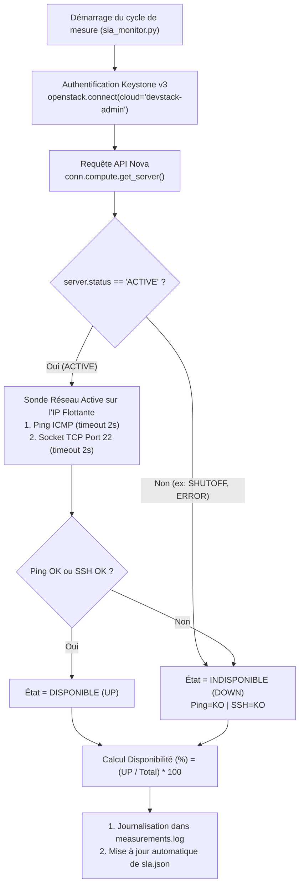

### 2 & 3. Conception du Démon de Surveillance Python (`openstacksdk`) et Journalisation

Conformément aux questions 2 et 3 du cahier des charges, nous avons développé un programme modulaire en Python (`partie04/sla_monitor.py`) qui automatise la collecte des métriques de disponibilité auprès d'OpenStack, journalise chaque sonde horodatée et calcule en continu le taux de disponibilité de chaque instance.

---

#### 2.1 Architecture logicielle et Authentification Keystone (`openstacksdk`)

Plutôt que d'exécuter des commandes shell externes peu fiables, notre script s'appuie directement sur le SDK officiel **`openstacksdk`** :

1.  **Authentification sécurisée via Keystone (`clouds.yaml`) :**
    La fonction `openstack.connect(cloud="devstack-admin")` lit automatiquement les paramètres d'authentification Keystone v3 depuis `/etc/openstack/clouds.yaml` sans exposer aucun mot de passe dans le code source.
2.  **Interrogation du Plan de Contrôle (API Nova) :**
    À chaque cycle d'évaluation, le programme appelle `conn.compute.find_server(inst_name)` puis `conn.compute.get_server(server.id)` afin d'obtenir l'état temps réel non mis en cache de la machine virtuelle (`server.status`) et d'extraire dynamiquement ses adresses IP privée et flottante.
3.  **Vérification du Plan de Données (Sonde Réseau Active ICMP + TCP/22) :**
    Si l'instance est à l'état `ACTIVE` dans Nova, le script exécute deux sondes réseau vers son IP flottante (`172.24.4.159` et `172.24.4.212`) :
    *   `check_icmp_ping(ip_address, timeout=2)` : Envoie un paquet ICMP Echo Request (`ping -c 1 -W 2`).
    *   `check_tcp_ssh(ip_address, port=22, timeout=2.0)` : Tente l'ouverture d'un socket TCP sur le port SSH 22 (`socket.create_connection`).



---

#### 2.2 Extrait du code clé de `sla_monitor.py`

Voici les fonctions principales assurant la double vérification (API Nova + Réseau), le calcul de la formule de disponibilité et la journalisation :

```python
# Interrogation de l'API Nova via openstacksdk
server = conn.compute.find_server(inst_name, ignore_missing=True)
if server is not None:
    server = conn.compute.get_server(server.id)
    nova_status = str(server.status).upper()
    fixed_ip, floating_ip = extract_instance_ips(server)
    target_ip = floating_ip or fixed_ip or "N/A"

    # Double validation : Plan de contrôle (Nova ACTIVE) + Plan de données (Ping ou SSH)
    if nova_status == "ACTIVE" and target_ip != "N/A":
        ping_ok = check_icmp_ping(target_ip)
        ssh_ok = check_tcp_ssh(target_ip, port=22)
        is_available = ping_ok or ssh_ok
    else:
        ping_ok = ssh_ok = is_available = False

# Calcul cumulé de la disponibilité selon la formule du SLA
stats[inst_name]["total_checks"] += 1
if is_available:
    stats[inst_name]["available_checks"] += 1
    sla_state = "DISPONIBLE"
else:
    stats[inst_name]["unavailable_checks"] += 1
    sla_state = "INDISPONIBLE"

total_c = stats[inst_name]["total_checks"]
up_c = stats[inst_name]["available_checks"]
avail_pct = (up_c / total_c) * 100.0
```

---

#### 2.3 Format du journal des mesures (`measurements.log`) et Extension d'une fenêtre courte à 24 heures

À chaque sonde, `sla_monitor.py` enregistre une entrée structurée dans `partie04/measurements.log` comprenant :
*   **La date et l'heure exactes en UTC** (`ISO-8601`),
*   **Le numéro du cycle**,
*   **Le nom de l'instance** (`instance-cirros-sla1` ou `instance-cirros-sla2`),
*   **L'état Nova** (`ACTIVE` ou `SHUTOFF`) et **l'état des sondes réseau** (`Ping=OK/KO`, `SSH=OK/KO`),
*   **L'état SLA résultant** (`DISPONIBLE` ou `INDISPONIBLE`),
*   **La disponibilité cumulée** (`Dispo=XX.XX% (up/total)`) et le statut (`SLA=OK` ou `SLA=BREACH`).

**Note méthodologique sur la période d'évaluation (Conformément au conseil du cahier des charges) :**
Le cahier des charges précise : *« Si votre machine ne peut pas rester allumée 24 heures, faites une période d'évaluation plus courte et expliquez dans le rapport comment le calcul s'étend à une journée. »*
*   La formule mathématique implémentée dans notre script ($\frac{\text{Mesures disponibles}}{\text{Mesures totales}} \times 100$) est **invariante par changement d'échelle** : elle fonctionne de manière strictement identique sur un échantillon de $N = 6\text{ cycles}$ lors de notre campagne de test que sur une journée complète de $N = 288\text{ cycles}$ (avec `--interval 300 --cycles 288`).
*   Pour passer de notre session de test à une surveillance de production de 24 heures, aucun changement de code n'est nécessaire : le script s'exécute simplement avec ses paramètres par défaut (`--interval 300 --cycles 288`).
