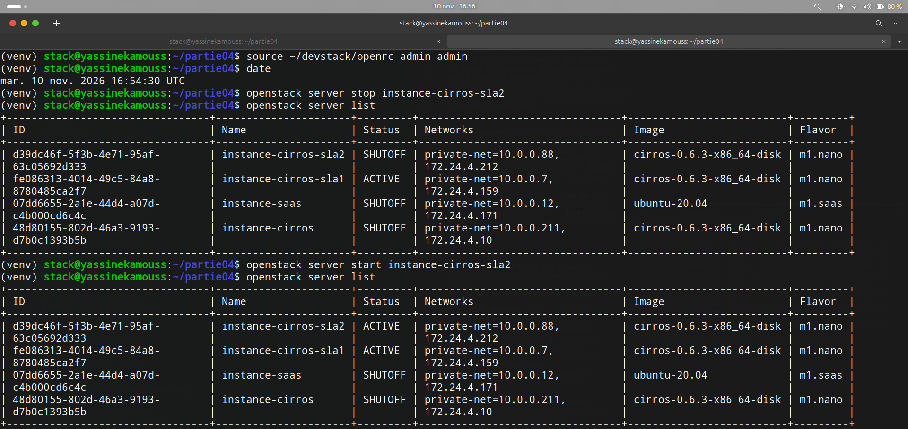
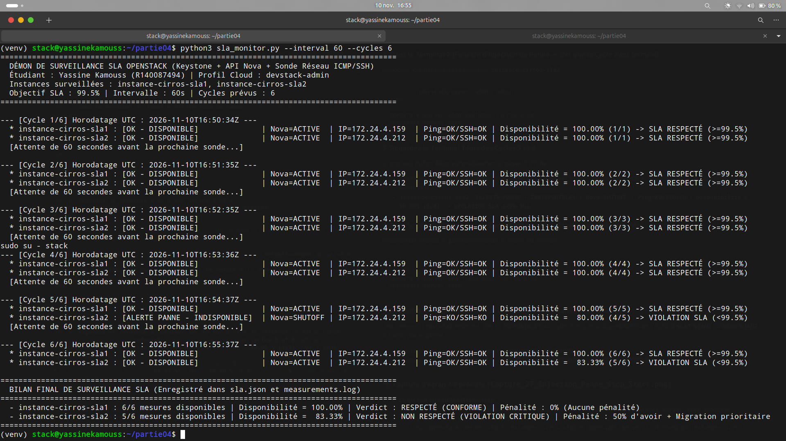
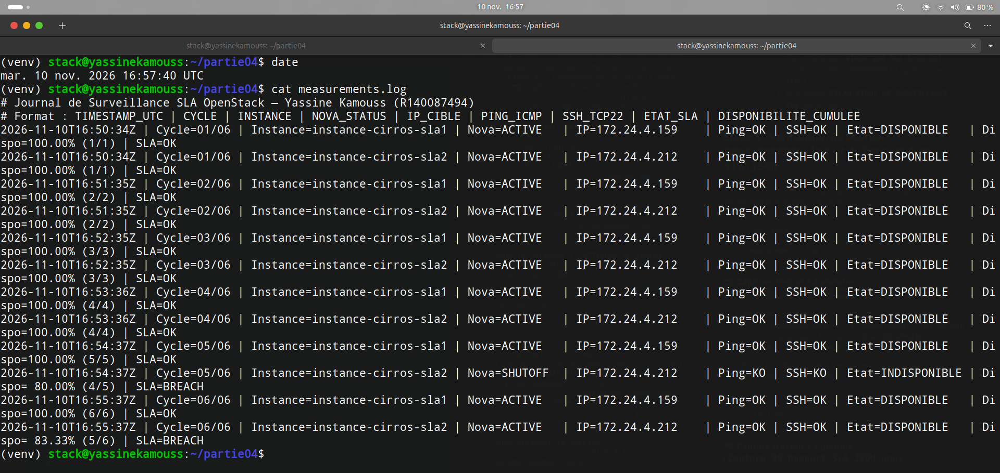
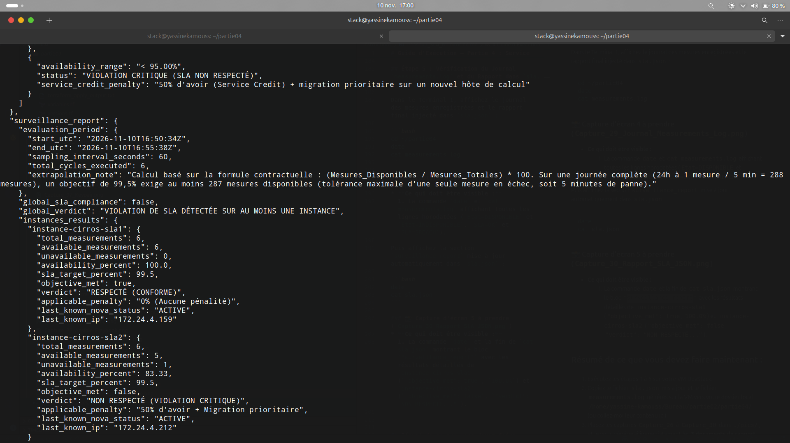

### 4 & 5. Simulation de Panne (Chaos Engineering), Détection Temps Réel et Rapport Final SLA

Pour valider expérimentalement l'efficacité de notre démon de surveillance `sla_monitor.py` et la mise à jour automatique du contrat `sla.json`, nous avons mené une campagne de surveillance sur 6 cycles consécutifs (`2026-11-10T16:50:34Z` à `2026-11-10T16:55:38Z`) au cours de laquelle nous avons provoqué une panne ciblée sur **`instance-cirros-sla2`** tout en maintenant **`instance-cirros-sla1`** en fonctionnement nominal.

---

#### 4.1 Protocole d'injection de panne (`openstack server stop` puis `start`)

Pendant que le démon `sla_monitor.py` surveillait les deux instances dans le premier terminal :
1.  **Cycles 1 à 4 (`16:50:34Z` → `16:53:36Z`) :** Les deux instances `instance-cirros-sla1` et `instance-cirros-sla2` sont à l'état `ACTIVE` et affichent **100,00 %** de disponibilité (`4/4`).
2.  **Injection de la panne avant le Cycle 5 (`16:54:30Z`) :** Dans un second terminal, nous avons arrêté `instance-cirros-sla2` via l'API OpenStack :
    ```bash
    date
    openstack server stop instance-cirros-sla2
    openstack server list
    ```
3.  **Rétablissement du service avant le Cycle 6 :** Dès que le Cycle 5 a détecté et enregistré la panne, nous avons redémarré l'instance :
    ```bash
    openstack server start instance-cirros-sla2
    openstack server list
    ```

**Capture d'écran 27 :** Injection de la panne sur `instance-cirros-sla2` (`openstack server stop` passant l'instance à l'état `SHUTOFF`), suivie de sa remise en service (`openstack server start` restaurant l'état `ACTIVE`).


---

#### 4.2 Détection de la panne et Impact sur la disponibilité en temps réel

Lors du **Cycle 5 (`16:54:37Z`)**, le programme `sla_monitor.py` a immédiatement détecté l'indisponibilité de `instance-cirros-sla2` sur les deux plans :
*   **Plan de Contrôle (API Nova) :** `Nova=SHUTOFF`
*   **Plan de Données (Réseau) :** `Ping=KO/SSH=KO`
*   **Impact immédiat sur la disponibilité :** La disponibilité de `instance-cirros-sla2` a chuté de **100,00 % (`4/4`)** à **80,00 % (`4/5`)**, déclenchant l'alerte **`[ALERTE PANNE - INDISPONIBLE]`** et le statut **`VIOLATION SLA (<99.5%)`**.
*   Au **Cycle 6 (`16:55:37Z`)**, suite au `openstack server start`, le moniteur a détecté le retour à la normale (`Nova=ACTIVE`, `Ping=OK/SSH=OK`), faisant remonter la disponibilité cumulée à **83,33 % (`5/6`)**, ce qui demeure inférieur au seuil contractuel de **99,5 %**.

**Capture d'écran 28 :** Exécution complète de `sla_monitor.py` montrant la détection de la panne au Cycle 5 (`[ALERTE PANNE - INDISPONIBLE] | Nova=SHUTOFF`), la baisse de disponibilité à `80.00%` puis `83.33%`, et le bilan final comparatif des deux instances.


---

#### 4.3 Vérification du journal des mesures (`measurements.log`)

L'intégralité des 12 mesures effectuées (6 cycles × 2 instances) a été enregistrée dans `partie04/measurements.log` :

```text
# Journal de Surveillance SLA OpenStack — Yassine Kamouss (R140087494)
# Format : TIMESTAMP_UTC | CYCLE | INSTANCE | NOVA_STATUS | IP_CIBLE | PING_ICMP | SSH_TCP22 | ETAT_SLA | DISPONIBILITE_CUMULEE
2026-11-10T16:50:34Z | Cycle=01/06 | Instance=instance-cirros-sla1 | Nova=ACTIVE   | IP=172.24.4.159 | Ping=OK | SSH=OK | Etat=DISPONIBLE   | Dispo=100.00% (1/1) | SLA=OK
2026-11-10T16:50:34Z | Cycle=01/06 | Instance=instance-cirros-sla2 | Nova=ACTIVE   | IP=172.24.4.212 | Ping=OK | SSH=OK | Etat=DISPONIBLE   | Dispo=100.00% (1/1) | SLA=OK
...
2026-11-10T16:54:37Z | Cycle=05/06 | Instance=instance-cirros-sla1 | Nova=ACTIVE   | IP=172.24.4.159 | Ping=OK | SSH=OK | Etat=DISPONIBLE   | Dispo=100.00% (5/5) | SLA=OK
2026-11-10T16:54:37Z | Cycle=05/06 | Instance=instance-cirros-sla2 | Nova=SHUTOFF  | IP=172.24.4.212 | Ping=KO | SSH=KO | Etat=INDISPONIBLE | Dispo= 80.00% (4/5) | SLA=BREACH
2026-11-10T16:55:37Z | Cycle=06/06 | Instance=instance-cirros-sla1 | Nova=ACTIVE   | IP=172.24.4.159 | Ping=OK | SSH=OK | Etat=DISPONIBLE   | Dispo=100.00% (6/6) | SLA=OK
2026-11-10T16:55:37Z | Cycle=06/06 | Instance=instance-cirros-sla2 | Nova=ACTIVE   | IP=172.24.4.212 | Ping=OK | SSH=OK | Etat=DISPONIBLE   | Dispo= 83.33% (5/6) | SLA=BREACH
```

**Capture d'écran 29 :** Affichage du journal horodaté `measurements.log` mettant en évidence la trace d'audit complète et le passage à `Etat=INDISPONIBLE` / `SLA=BREACH` au Cycle 05/06.


---

#### 4.4 Ajout automatique du Rapport de Surveillance au fichier `sla.json`

Conformément à la Question 5 du cahier des charges, le script `sla_monitor.py` a automatiquement injecté la section `"surveillance_report"` à la fin du fichier `partie04/sla.json` avec la période exacte, le nombre de mesures, la disponibilité de chaque instance et le respect ou non de l'objectif :

| Instance surveillée | Adresse IP Flottante | Mesures Disponibles / Totales | Disponibilité Calculée | Objectif SLA ($\ge 99,5\%$) | Verdict Contractuel | Pénalité Applicable |
| :--- | :---: | :---: | :---: | :---: | :---: | :--- |
| **`instance-cirros-sla1`** *(Témoin)* | `172.24.4.159` | $6 / 6$ | **100,00 %** | **Oui (`true`)** | `RESPECTÉ (CONFORME)` | 0 % (Aucune pénalité) |
| **`instance-cirros-sla2`** *(Cible panne)* | `172.24.4.212` | $5 / 6$ | **83,33 %** | **Non (`false`)** | `NON RESPECTÉ (VIOLATION CRITIQUE)` | 50 % d'avoir + Migration prioritaire |

**Capture d'écran 30 :** Inspection du fichier `sla.json` enrichi automatiquement avec le bloc `"surveillance_report"`, confirmant la conformité de `instance-cirros-sla1` (`100.0%`) et la violation de SLA sur `instance-cirros-sla2` (`83.33%`).

