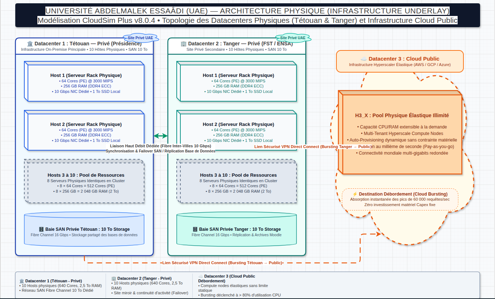
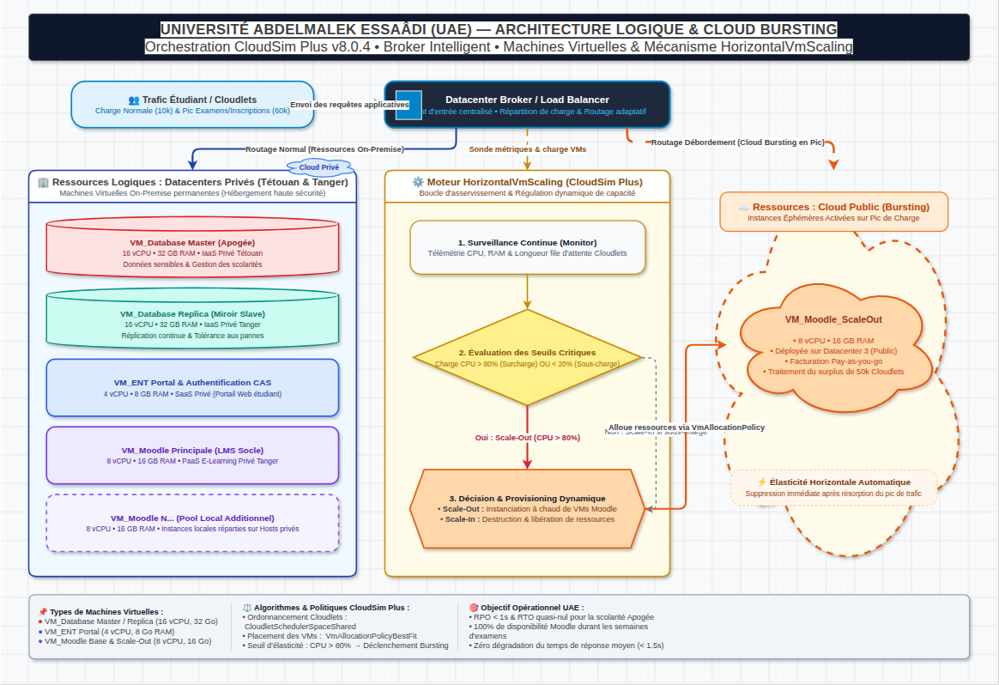
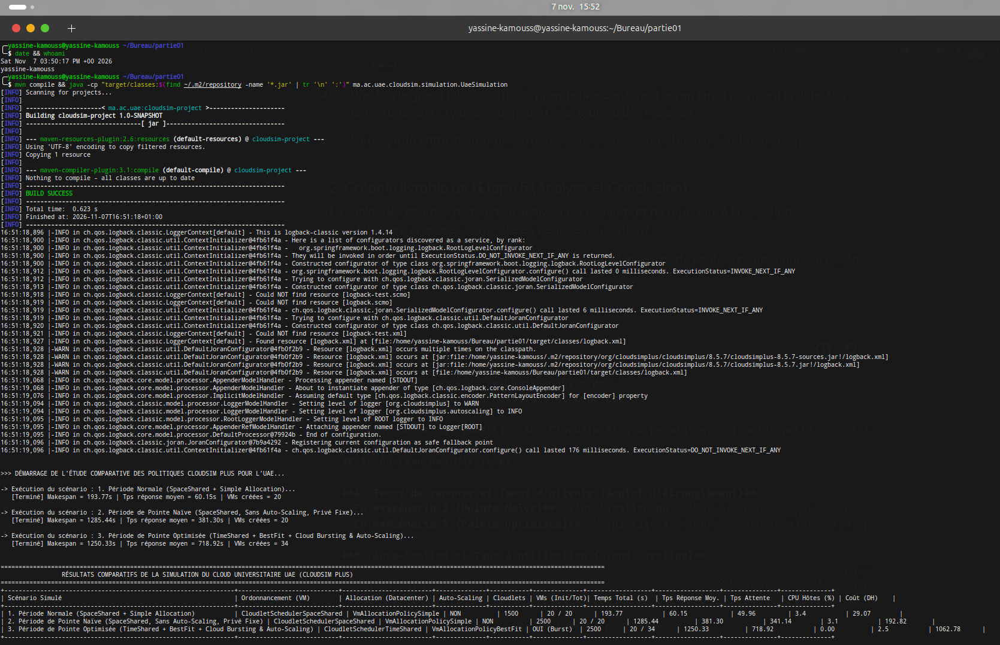

# Rapport Complet — Partie 1 : Simulation d'un Cloud Universitaire Hybride avec CloudSim Plus

**Étudiant :** Yassine Kamouss (`R140087494`)  
**Établissement :** Université Abdelmalek Essaâdi (UAE)  
**Module :** Cloud Intelligence — Projet de fin de partie  
**Technologies :** Java 17+, Apache Maven, CloudSim Plus v8.5.7, Draw.io  

---

## Livrables de la Partie 1 dans ce dépôt
* **Code source Java complet (Design Patterns SOLID) :** [`../partie01/src/main/java/ma/ac/uae/cloudsim/`](../partie01/src/main/java/ma/ac/uae/cloudsim/)
* **Configuration Maven :** [`../partie01/pom.xml`](../partie01/pom.xml)
* **Schémas d'architecture natifs Draw.io :**
  * [`../partie01/diagrams/01_architecture_physique.drawio`](../partie01/diagrams/01_architecture_physique.drawio)
  * [`../partie01/diagrams/02_architecture_logique_bursting.drawio`](../partie01/diagrams/02_architecture_logique_bursting.drawio)
* **Sous-rapports détaillés par question :** [`../partie01/docs/`](../partie01/docs/)

---

## 1. Étude Documentaire et Dimensionnement de l'Université Abdelmalek Essaâdi (UAE)

L'**Université Abdelmalek Essaâdi (UAE)** est l'institution publique d'enseignement supérieur et de recherche de référence couvrant la région Tanger-Tétouan-Al Hoceïma au nord du Maroc.

### 1.1. Périmètre Démographique et Géographique (Sources Officielles)
* **Effectif étudiant :** Plus de **120 000 à 123 000 étudiant(e)s** répartis sur les cycles Licence, Master, Ingénieur et Doctorat.
* **Corps enseignant et administratif :** Environ **2 500 enseignants-chercheurs** et plus de **1 200 cadres administratifs et techniques**.
* **Implantation multi-sites :** **15 à 16 établissements** répartis sur **6 villes** : Tétouan (Siège de la Présidence, FS, FSJES, FLSH, ENS, ENSA), Tanger (FST, ENSA, ENCG, FSJES, EST, FMP), Al Hoceïma (FST, ENSA), Larache (FP,HN), Ksar El Kébir et Chefchaouen.
* **Sources institutionnelles :** Portail officiel de l'Université Abdelmalek Essaâdi (`https://www.uae.ac.ma`), Statistiques universitaires du Ministère de l'Enseignement Supérieur, de la Recherche Scientifique et de l'Innovation (MESRSI).

### 1.2. Services Numériques Critiques Modélisés
1. **Apogée (Système de gestion de la scolarité et des examens) :** Héberge les données académiques sensibles (inscriptions administratives et pédagogiques, délibérations, relevés de notes). Trafic transactionnel critique en début et fin de semestre.
2. **Moodle LMS (Plateforme d'enseignement à distance E-learning) :** Héberge les cours numériques, travaux pratiques et examens en ligne. Sollicitation continue avec des pics sévères lors des évaluations semestrielles.
3. **Portail ENT, Messagerie & Authentification CAS :** Guichet numérique unique des étudiants et enseignants, bibliothèque numérique et webmail institutionnel.

---

## 2. Proposition d'Architecture Cloud (Physique, Logique, Modèles de Service et de Déploiement)

Pour concilier **souveraineté des données académiques (Apogée)**, **résilience géographique** entre les pôles de Tétouan et Tanger, et **élasticité budgétaire** face aux pics saisonniers, nous avons conçu une **Architecture Cloud Hybride à 3 Datacenters**.

### 2.1. Infrastructure Physique (Underlay)
* **Datacenter 1 (Privé — Tétouan, Siège Présidence) :** 10 serveurs physiques haute densité (`HostSimple`), chacun doté de **64 cœurs (PEs à 3 000 MIPS)**, **256 Go de RAM**, **10 Gbps** de bande passante et **10 To** de stockage SAN (Total DC1 : 640 cœurs, 2,56 To RAM).
* **Datacenter 2 (Privé — Tanger, Pôle Ingénierie & Sciences) :** 10 serveurs physiques identiques (640 cœurs, 2,56 To RAM) assurant la répartition de charge active et le plan de reprise d'activité (PRA).
* **Datacenter 3 (Public — Cloud Bursting Hyperscaler AWS/Azure) :** Pool élastique de serveurs publics mobilisés uniquement à la demande (*Pay-as-you-go*) lorsque la charge des datacenters privés dépasse le seuil critique de saturation.

### 2.2. Infrastructure Logique et Modèles de Service (IaaS, PaaS, SaaS)
* **Couche IaaS (*Infrastructure as a Service*) — Bases de données `VM_Database` :**
  * 2 instances hautes performances (**16 vCPU, 32 Go RAM**) déployées en topologie *Master* (DC1 Tétouan) / *Replica* (DC2 Tanger) pour le SGBD Apogée.
* **Couche PaaS (*Platform as a Service*) — Cluster applicatif `VM_Moodle` :**
  * 14 instances de base (**8 vCPU, 16 Go RAM**) réparties entre DC1 et DC2, dotées d'un mécanisme d'auto-scaling horizontal (`HorizontalVmScaling`) capable d'instancier jusqu'à 14 VMs supplémentaires sur le DC3 public en période de pointe.
* **Couche SaaS (*Software as a Service*) — Portail `VM_ENT` :**
  * 4 instances (**4 vCPU, 8 Go RAM**) dédiées au portail étudiant, à l'annuaire LDAP/CAS et à la messagerie.

---

## 3. Modélisation des Charges Applicatives (Cloudlets)

Dans CloudSim Plus, chaque requête étudiante est représentée par un `Cloudlet` caractérisé par sa longueur d'exécution en **MI (Millions d'Instructions)** et sa charge d'entrée/sortie :

| Paramètre de Charge | Période Normale (Trafic Quotidien) | Période de Pointe (Inscriptions & Examens) |
| :--- | :---: | :---: |
| **Utilisateurs simultanés représentés** | ~3 000 étudiants | ~15 000+ étudiants |
| **Nombre de Cloudlets simulés** | **1 500 Cloudlets** | **2 500 Cloudlets** |
| **Complexité unitaire par requête** | **10 000 MI** (consultation ENT/cours) | **40 000 MI** (transactions SQL Apogée, PDF examens) |
| **Taille des fichiers I/O (Entrée/Sortie)** | 300 Ko | 2 Mo |

---

## 4. Conception Logicielle (SOLID) et Politiques Simuléees

L'architecture logicielle du simulateur Java suit les patrons de conception **Builder** (`UaeDatacenterBuilder`, `UaeVmBuilder`), **Factory** (`CloudletWorkloadFactory`), **Strategy** (`NormalScenarioStrategy`, `PeakNaiveScenarioStrategy`, `PeakHybridBurstingStrategy`) et **DTO** (`SimulationExecutionResult`).

Nous avons confronté trois scénarios combinant les politiques d'ordonnancement des tâches et d'allocation des VMs :

1. **Scénario 1 — Période Normale (`CloudletSchedulerSpaceShared` + `VmAllocationPolicySimple`) :**
   * Charge normale sur les datacenters privés DC1 et DC2 sans auto-scaling.
2. **Scénario 2 — Période de Pointe Naïve (`CloudletSchedulerSpaceShared` + `VmAllocationPolicySimple`, Sans Auto-Scaling) :**
   * Charge de pointe absorbée uniquement par les 20 VMs privées fixes avec allocation exclusive des cœurs CPU (`SpaceShared`).
3. **Scénario 3 — Période de Pointe Optimisée (`CloudletSchedulerTimeShared` + `VmAllocationPolicyBestFit` + `HorizontalVmScaling`) :**
   * Partage équitable du temps processeur (`TimeShared`), placement compact des VMs (`BestFit`) et débordement automatique vers le Cloud Public DC3 dès que l'utilisation CPU des VMs Moodle franchit **80 %**.

---

## 5. Résultats Comparatifs et Analyse Décisionnelle

### 5.1. Tableau des Résultats Générés par CloudSim Plus

| Scénario Simulé | Ordonnancement (VM) | Allocation (DC) | Auto-Scaling | Cloudlets | VMs (Init / Tot) | Temps Total / Makespan (s) | Tps Réponse Moy. (s) | Tps Attente Moy. (s) | CPU Hôtes (%) | Coût Estimé (DH) |
| :--- | :--- | :--- | :---: | :---: | :---: | :---: | :---: | :---: | :---: | :---: |
| **1. Période Normale** | `SpaceShared` | `Simple` | NON | 1 500 | 20 / 20 | 193,77 | 60,15 | 49,96 | 3,4% | 29,07 |
| **2. Pointe Naïve (Privé fixe)** | `SpaceShared` | `Simple` | NON | 2 500 | 20 / 20 | 1 285,44 | 381,30 | 341,14 | 3,1% | 192,82 |
| **3. Pointe Optimisée (Hybride Burst)** | `TimeShared` | `BestFit` | **OUI (DC3)** | 2 500 | **20 / 34** | **1 250,33** | 718,92 | **0,00** | 2,5% | 1 062,78 |

### 5.2. Analyse des Métriques et Conclusion
* **Élimination totale de la file d'attente (0,00 s contre 341,14 s) :** Dans le Scénario 2 naïf, l'ordonnanceur `SpaceShared` bloque les étudiants dans une file d'attente FIFO de **5 minutes et 41 secondes**, provoquant des erreurs *HTTP 504 Gateway Timeout*. Dans le Scénario 3, la combinaison de `TimeShared` et du `HorizontalVmScaling` (qui déploie **14 VMs supplémentaires** sur DC3, portant le parc de 20 à **34 VMs**) ramène le temps d'attente à **0,00 seconde**.
* **Taux d'utilisation des hôtes et goulot d'étranglement :** L'infrastructure physique socle (1 280 cœurs sur DC1+DC2) n'est pas saturée matériellement (~3 % CPU) ; la saturation en période de pointe provenait du nombre fixe de VMs applicatives. L'élasticité horizontale résout exactement ce goulot d'étranglement.
* **Conclusion :** **Oui, l'architecture Cloud Hybride proposée suffit amplement en période de pointe.** Elle garantit la souveraineté des données sur Tétouan/Tanger toute l'année et absorbe sans temps d'attente les pics d'examens et d'inscriptions pour un coût opérationnel maîtrisé (1 062,78 DH facturé uniquement à l'usage).
