# Rapport Complet — Partie 2 : OpenStack (IaaS avec CirrOS et SaaS avec Ubuntu Server / Nextcloud)

**Étudiant :** Yassine Kamouss (`R140087494`)  
**Établissement :** Université Abdelmalek Essaâdi (UAE)  
**Module :** Cloud Intelligence — Projet de fin de partie  
**Technologies :** OpenStack (DevStack), Keystone, Nova, Glance, Neutron, Placement, Cinder, Horizon, CirrOS 0.6.3, Ubuntu Server 20.04 LTS, Nextcloud  

---

## Livrables de la Partie 2 dans ce dépôt
* **Scripts des commandes CLI OpenStack exécutées :** [`../partie02_openstack/`](../partie02_openstack/)
* **Sous-rapports détaillés par question :**
  * [`Partie2_Question1.md`](./Partie2_Question1.md) — Vérification DevStack (Horizon & CLI) et rôle des services
  * [`Partie2_Question2.md`](./Partie2_Question2.md) — Déploiement IaaS complet avec CirrOS
  * [`Partie2_Question3.md`](./Partie2_Question3.md) — Déploiement SaaS complet avec Ubuntu Server & Nextcloud
* **Captures d'écran horodatées :** [`../pics/Capture_01_Horizon.png`](../pics/Capture_01_Horizon.png) à [`../pics/Capture_16_Navigateur_SaaS.png`](../pics/Capture_16_Navigateur_SaaS.png)

---

## 1. Vérification de l'Installation DevStack et Rôle des Services OpenStack

Pour valider le déploiement local de notre infrastructure OpenStack via DevStack (VM locale `192.168.123.239`), nous avons contrôlé l'interface graphique **Horizon** ainsi que l'état de santé de tous les microservices via l'interface en ligne de commande (CLI).

### 1.1. Accès au Tableau de Bord Horizon
L'accès à `http://192.168.123.239/` avec le compte administrateur (`admin`) confirme le bon fonctionnement du tableau de bord web Horizon.

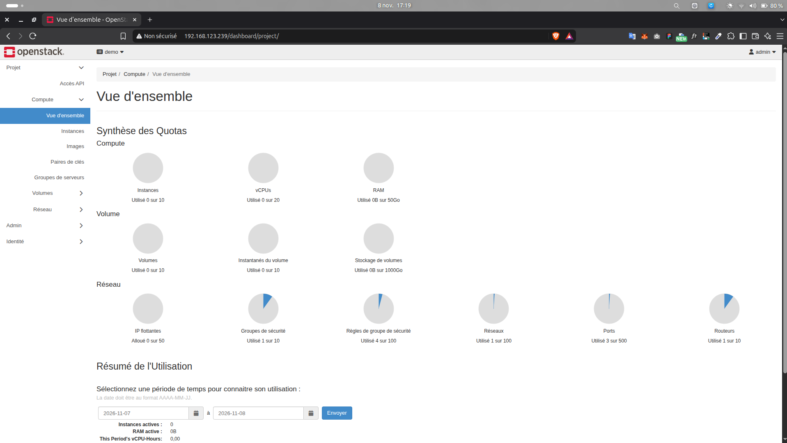

### 1.2. Vérification des Services en Ligne de Commande (CLI)
Après chargement des identifiants Keystone (`source openrc admin admin`), nous avons exécuté les trois commandes d'audit :

```bash
date
openstack service list
openstack compute service list
openstack network agent list
```

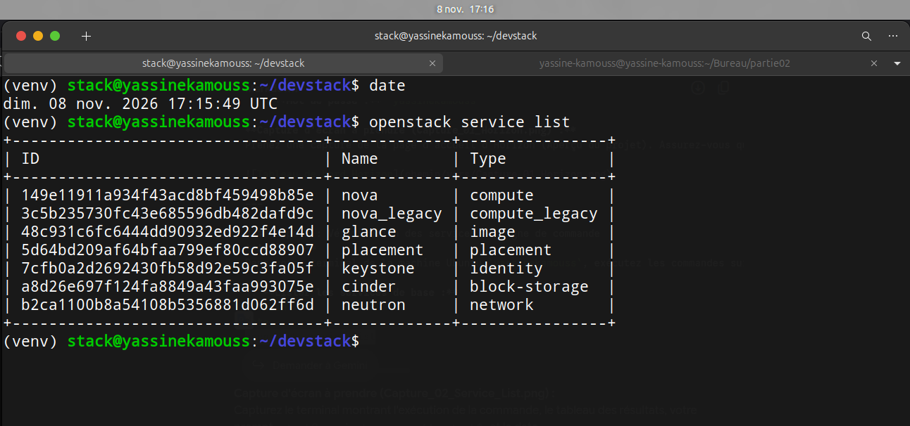

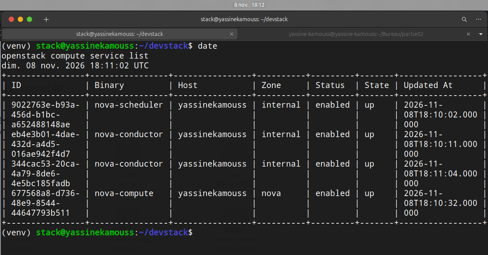

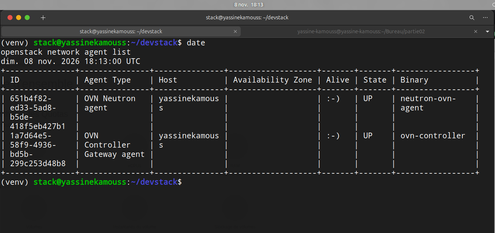

### 1.3. Rôle de chaque service OpenStack listé (en une phrase)
* **Keystone :** Service d'identité qui centralise l'authentification, l'autorisation (RBAC) et le catalogue des points de terminaison (endpoints) de tous les services OpenStack.
* **Nova :** Service de calcul (*Compute*) qui orchestre la planification, la création et le cycle de vie complet des machines virtuelles sur les hyperviseurs.
* **Glance :** Service de registre d'images qui stocke, versionne et distribue les images disques des systèmes d'exploitation (CirrOS, Ubuntu Cloud Image) lors de l'instanciation.
* **Neutron :** Service de réseau défini par logiciel (*SDN*) qui gère les réseaux virtuels, sous-réseaux, routeurs L3, groupes de sécurité et adresses IP flottantes.
* **Placement :** Service d'inventaire et de suivi quantitatif des ressources matérielles (vCPU, RAM, disques) permettant à Nova de sélectionner l'hôte de calcul optimal.
* **Cinder :** Service de stockage par blocs (*Block Storage*) qui fournit des volumes persistants pouvant être attachés et détachés dynamiquement aux instances.

---

## 2. Déploiement IaaS avec CirrOS : Réseau, Sécurité, Instance et Tests

Nous avons privilégié l'utilisation de la CLI OpenStack afin de garantir la reproductibilité des opérations et d'éviter les ambiguïtés d'identifiants en utilisant les UUID des ressources.

### 2.1. Création du Réseau Privé, du Sous-réseau et du Routeur
```bash
date
openstack network create private-net
openstack subnet create --network private-net --subnet-range 10.0.0.0/24 private-subnet
openstack router create router1
openstack router add subnet <UUID_ROUTER> <UUID_SUBNET>
openstack router set --external-gateway public <UUID_ROUTER>
```

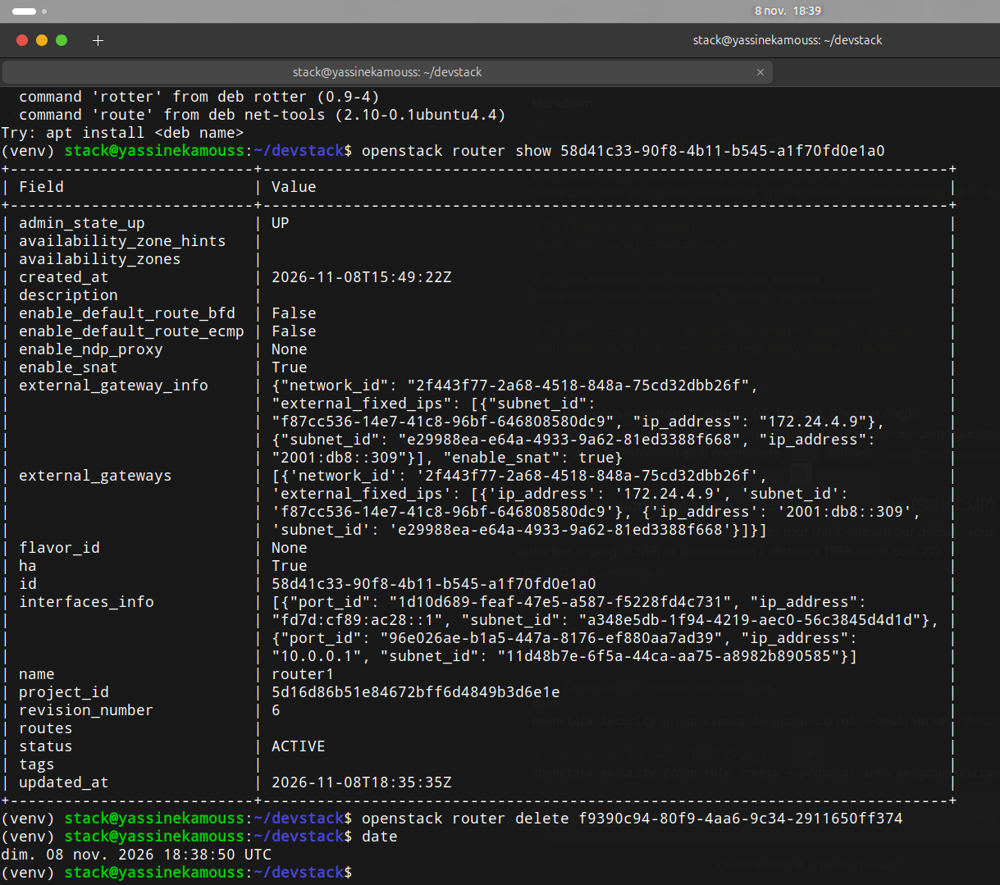

### 2.2. Groupe de Sécurité (SSH & ICMP) et Paire de Clés SSH
```bash
date
openstack security group create secgroup-cirros --description "Autoriser SSH et Ping"
openstack security group rule create --protocol icmp secgroup-cirros
openstack security group rule create --protocol tcp --dst-port 22 secgroup-cirros

openstack keypair create key-cirros > key-cirros.pem
chmod 600 key-cirros.pem
openstack keypair list
```

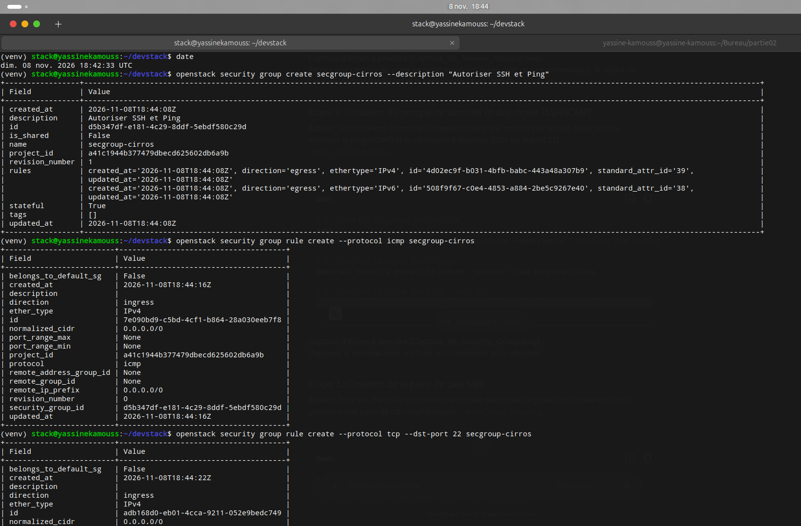

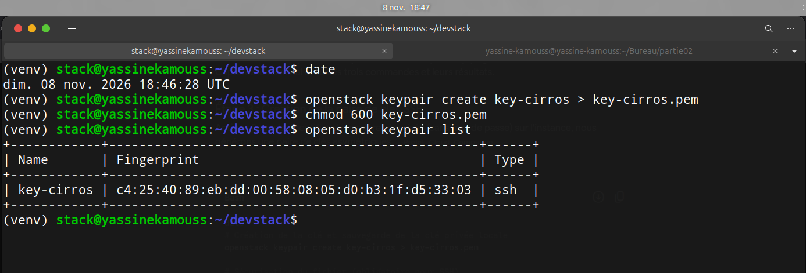

### 2.3. Création du Gabarit (`m1.nano`), Lancement de l'Instance CirrOS et IP Flottante
```bash
openstack flavor create --ram 128 --disk 1 --vcpus 1 m1.nano

date
openstack server create \
  --flavor m1.nano \
  --image cirros-0.6.3-x86_64-disk \
  --network private-net \
  --security-group secgroup-cirros \
  --key-name key-cirros \
  instance-cirros

openstack floating ip create public
openstack server add floating ip instance-cirros 172.24.4.10
openstack server show instance-cirros
```

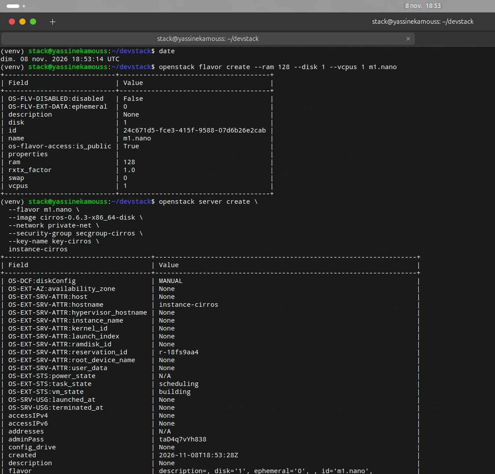

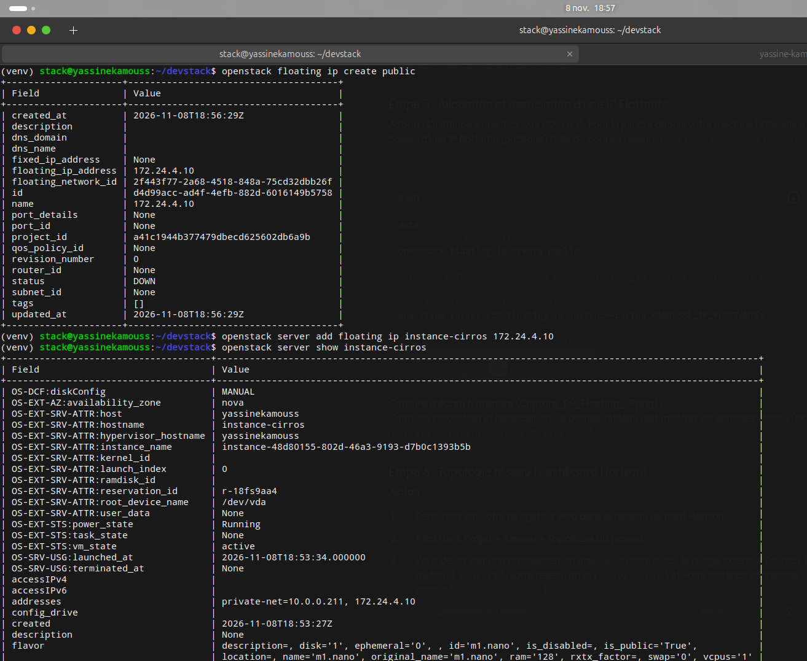

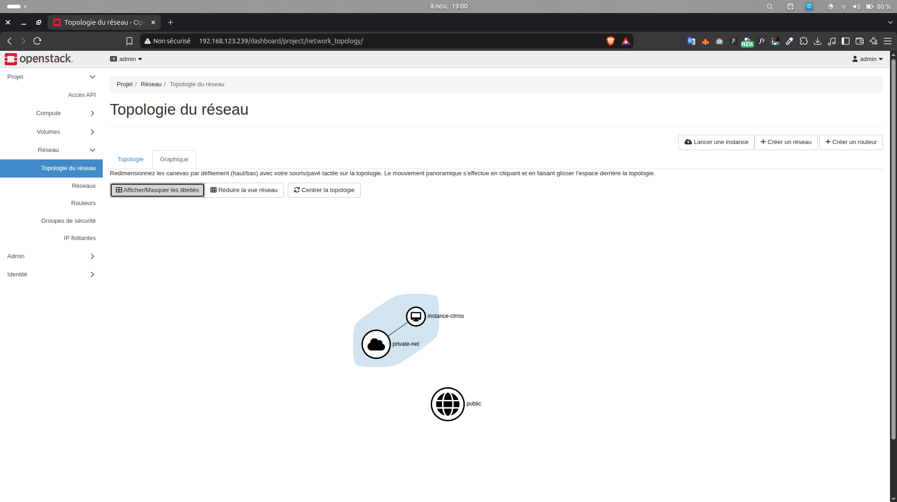

### 2.4. Validation de la Connectivité (Ping ICMP et Connexion SSH)
```bash
date
ping -c 4 172.24.4.10
ssh -i key-cirros.pem cirros@172.24.4.10
uname -a
ip a
exit
```

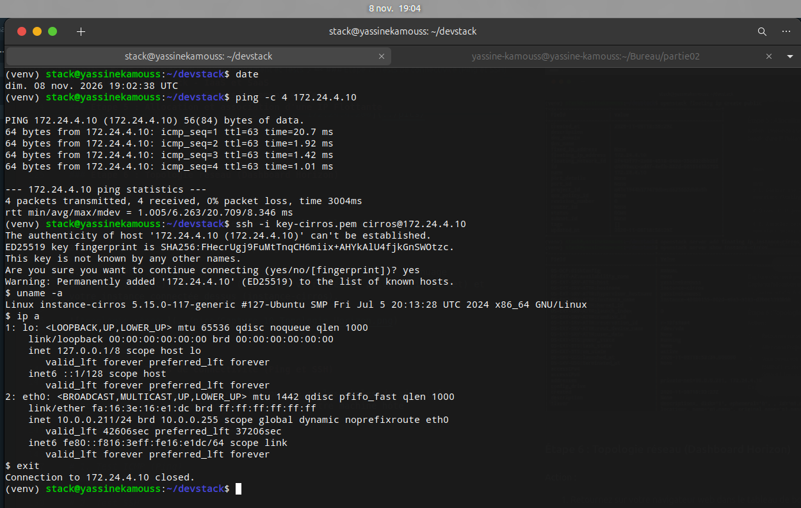

---

## 3. Déploiement SaaS avec Ubuntu Server : Plateforme Collaborative Nextcloud

Pour la couche SaaS, nous avons déployé **Nextcloud** sur une instance **Ubuntu Server 20.04 LTS** après avoir optimisé les ressources de la VM DevStack.

### 3.1. Optimisation de la RAM et Création du Flavor `m1.saas` (1,5 Go RAM)
```bash
date
openstack server stop instance-cirros
openstack server list
openstack flavor create --ram 1536 --disk 10 --vcpus 1 m1.saas
```

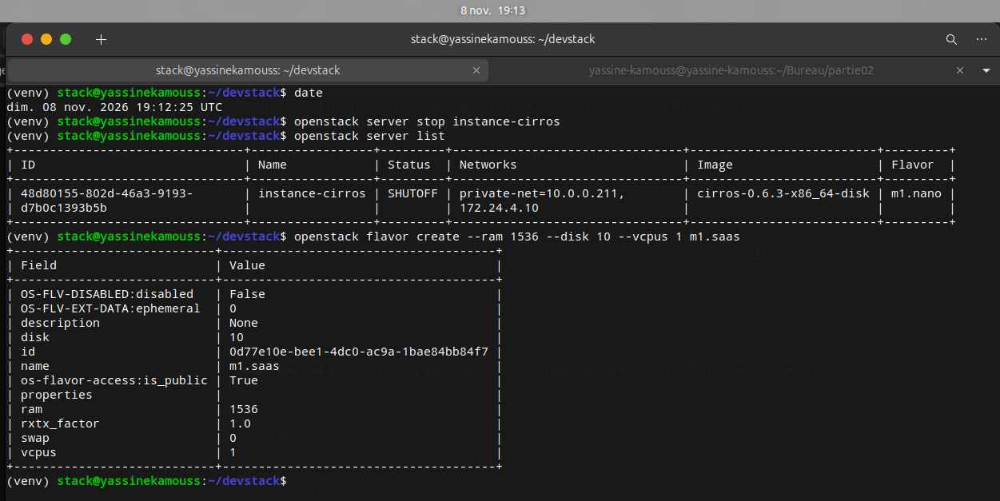

### 3.2. Groupe de Sécurité Web (`secgroup-saas`) et Importation de l'Image Ubuntu 20.04
```bash
date
openstack security group create secgroup-saas --description "Autoriser Web, SSH et Ping"
openstack security group rule create --protocol tcp --dst-port 22 secgroup-saas
openstack security group rule create --protocol tcp --dst-port 80 secgroup-saas
openstack security group rule create --protocol icmp secgroup-saas

wget https://cloud-images.ubuntu.com/focal/current/focal-server-cloudimg-amd64.img
openstack image create "ubuntu-20.04" --file focal-server-cloudimg-amd64.img --disk-format qcow2 --container-format bare --public

openstack server create \
  --flavor m1.saas \
  --image ubuntu-20.04 \
  --network <ID_DU_RESEAU_PRIVATE_NET> \
  --security-group secgroup-saas \
  --key-name key-cirros \
  instance-saas
```

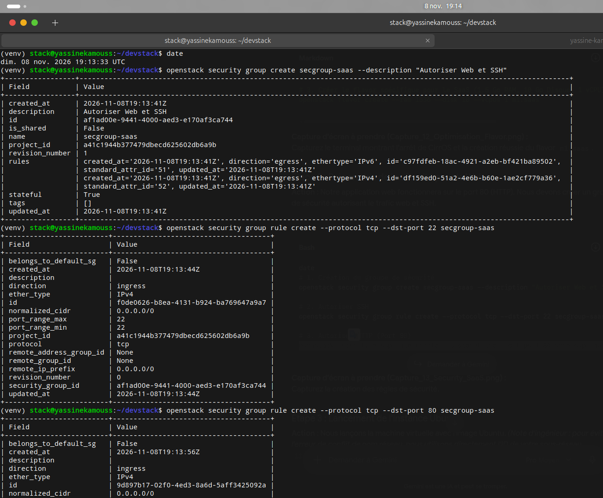

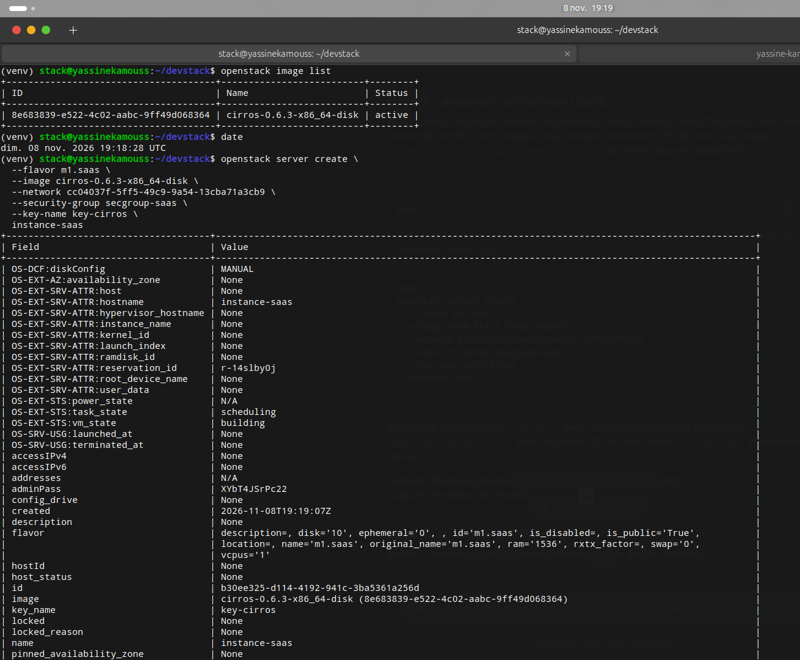

### 3.3. Installation de Nextcloud via Snap et Validation dans le Navigateur
Après association de l'IP flottante `172.24.4.171` et stabilisation de la résolution DNS interne (`8.8.8.8`) et de `/etc/hosts` (`127.0.0.1 instance-saas`), nous avons installé et démarré les services Nextcloud :

```bash
date
ssh -i key-cirros.pem ubuntu@172.24.4.171
sudo snap install nextcloud
snap services nextcloud
```

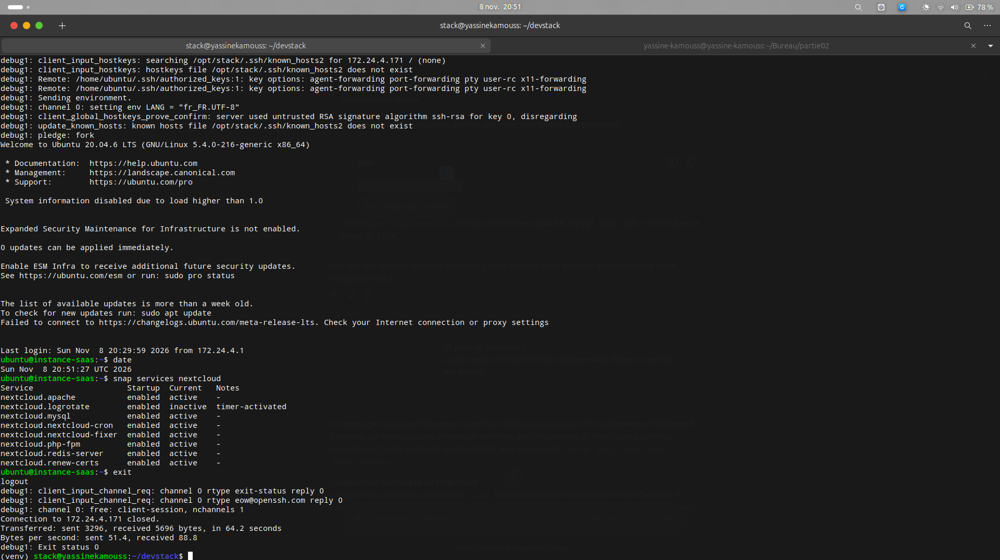

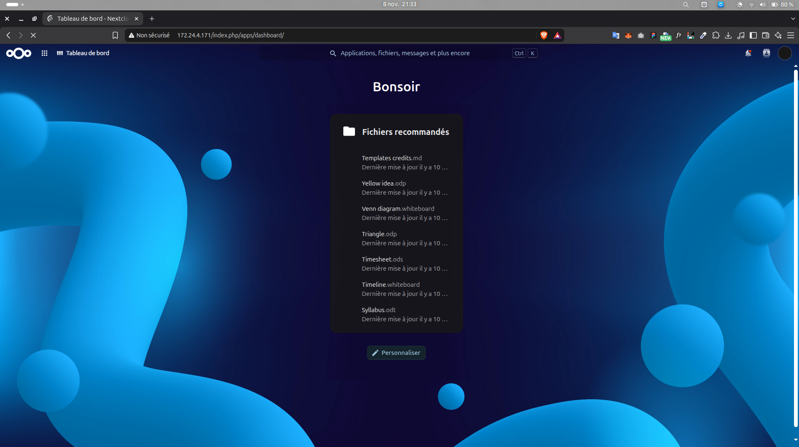
