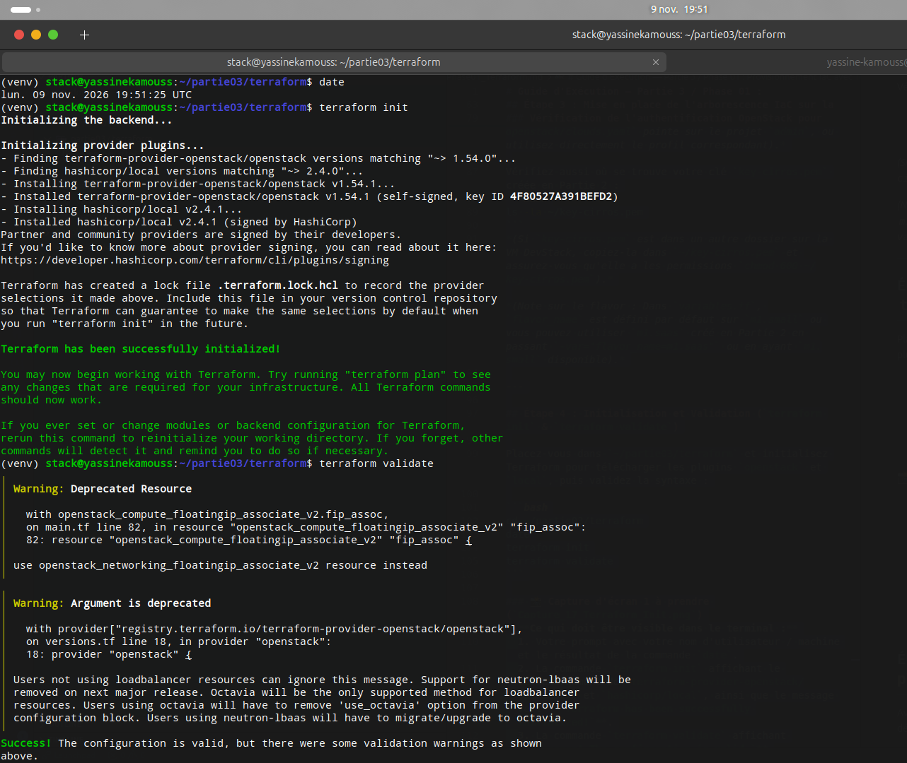
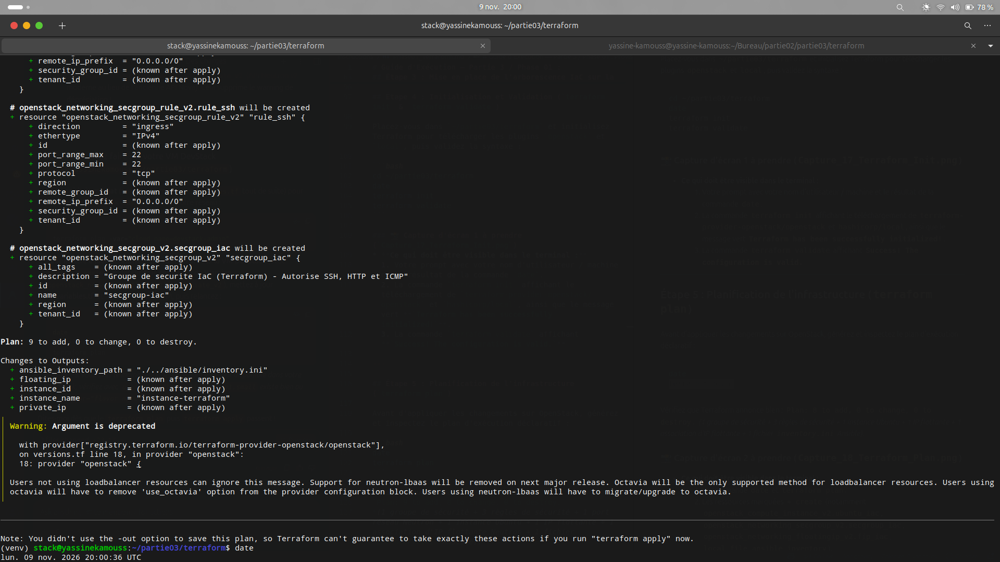
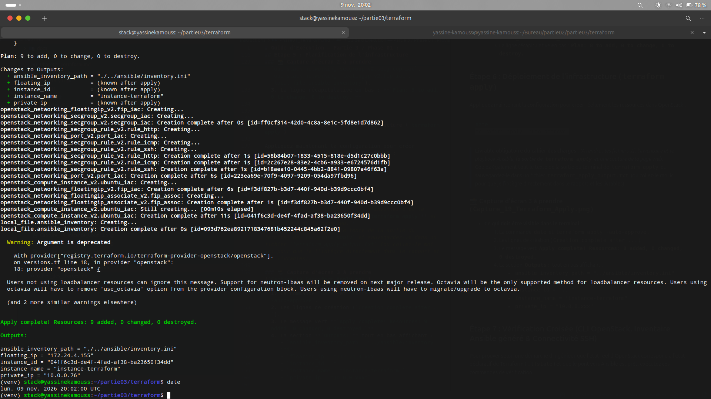
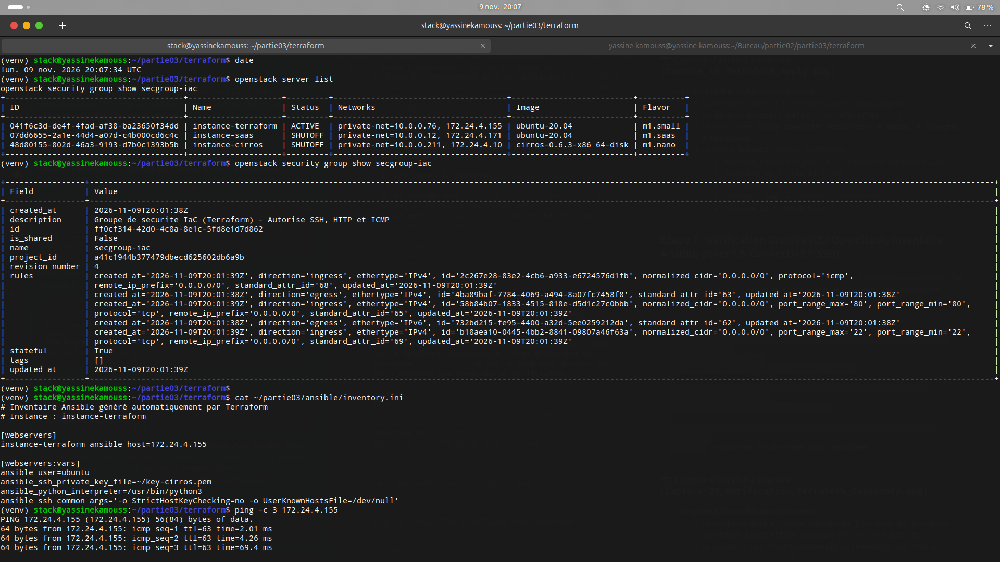
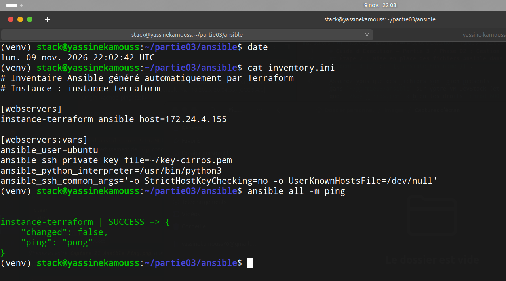
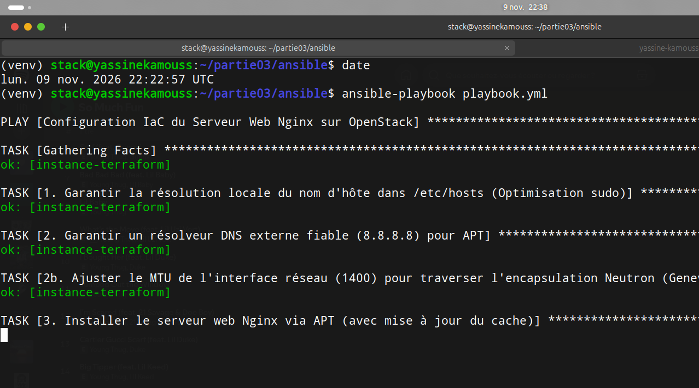
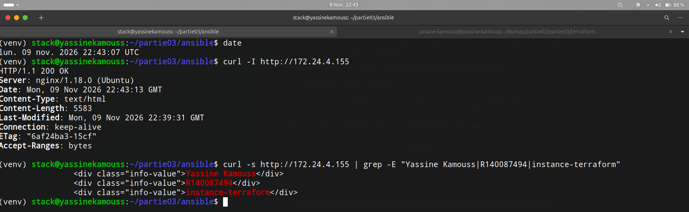
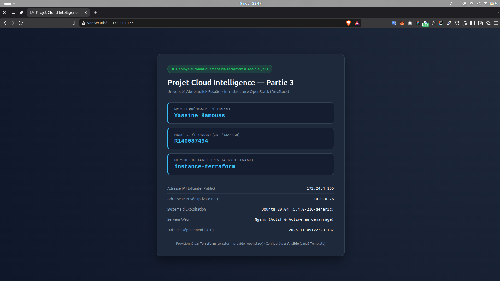
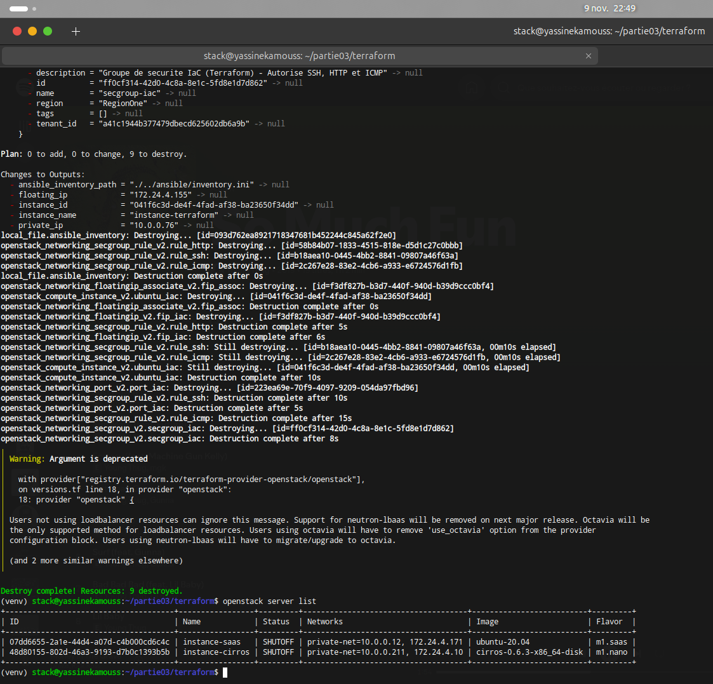

# Rapport Complet — Partie 3 : Infrastructure as Code (Terraform & Ansible)

**Étudiant :** Yassine Kamouss (`R140087494`)  
**Établissement :** Université Abdelmalek Essaâdi (UAE)  
**Module :** Cloud Intelligence — Projet de fin de partie  
**Technologies :** Terraform (`terraform-provider-openstack` v1.54, `hashicorp/local` v2.4), Ansible (`ansible-core` 2.16 LTS, Jinja2), OpenStack, Ubuntu 20.04 LTS, Nginx  

---

## Livrables de la Partie 3 dans ce dépôt
* **Fichiers Terraform (`.tf` et `.tftpl`) :**
  * [`../partie03/terraform/versions.tf`](../partie03/terraform/versions.tf)
  * [`../partie03/terraform/variables.tf`](../partie03/terraform/variables.tf)
  * [`../partie03/terraform/main.tf`](../partie03/terraform/main.tf)
  * [`../partie03/terraform/outputs.tf`](../partie03/terraform/outputs.tf)
  * [`../partie03/terraform/inventory.tftpl`](../partie03/terraform/inventory.tftpl)
* **Sortie complète de `terraform apply` :** [`../partie03/terraform/terraform_apply_output.txt`](../partie03/terraform/terraform_apply_output.txt)
* **Inventaire, Configuration, Playbook et Template Ansible :**
  * [`../partie03/ansible/inventory.ini`](../partie03/ansible/inventory.ini) *(généré automatiquement par Terraform)*
  * [`../partie03/ansible/ansible.cfg`](../partie03/ansible/ansible.cfg)
  * [`../partie03/ansible/playbook.yml`](../partie03/ansible/playbook.yml)
  * [`../partie03/ansible/templates/index.html.j2`](../partie03/ansible/templates/index.html.j2)
* **Sous-rapports détaillés par question :**
  * [`Partie3_Question1.md`](./Partie3_Question1.md) — Provisionnement déclaratif avec Terraform
  * [`Partie3_Question2.md`](./Partie3_Question2.md) — Configuration automatisée avec Ansible & Nginx
  * [`Partie3_Question3.md`](./Partie3_Question3.md) — Étude comparative Terraform vs Ansible

---

## 1. Provisionnement Déclaratif de l'Infrastructure avec Terraform

Conformément aux bonnes pratiques d'ingénierie DevOps, nous avons structuré notre code Terraform de manière modulaire et sans aucun secret écrit en dur (*Zero Hardcoded Credentials*), en nous appuyant sur le profil `devstack-admin` du fichier `/etc/openstack/clouds.yaml`.

### 1.1. Architecture des Ressources Déclarées (`partie03/terraform/`)
1. **Source de données (`data.openstack_networking_network_v2.private_net`) :** Récupère dynamiquement l'UUID du réseau `private-net` (`cc04037f-5ff5-49c9-9a54-13cba71a3cb9`).
2. **Groupe de sécurité (`openstack_networking_secgroup_v2.secgroup_iac`) :** Crée le groupe `secgroup-iac` et ses 3 règles entrantes autorisant **SSH (TCP/22)**, **HTTP (TCP/80)** et **ICMP**.
3. **Port Neutron et Instance Ubuntu (`openstack_networking_port_v2.port_iac` & `openstack_compute_instance_v2.ubuntu_iac`) :** Déploie l'instance `instance-terraform` (image `ubuntu-20.04`, gabarit `m1.small`, clé `key-cirros`) avec initialisation `cloud-init` du DNS.
4. **IP Flottante (`openstack_networking_floatingip_v2` & `openstack_networking_floatingip_associate_v2`) :** Alloue l'IP flottante `172.24.4.155` depuis le pool `public` et l'associe au port Neutron de l'instance.
5. **Génération automatique de l'inventaire Ansible (`local_file.ansible_inventory`) :** Génère directement `../ansible/inventory.ini` à partir du template `inventory.tftpl` dès que l'IP flottante est attribuée.

### 1.2. Cycle d'Exécution : `terraform init`, `validate`, `plan` et `apply`

```bash
date
terraform init
terraform validate
terraform plan
terraform apply -auto-approve
```







**Sorties (`Outputs`) obtenues à l'issue de `terraform apply` :**
```text
Apply complete! Resources: 9 added, 0 changed, 0 destroyed.

Outputs:

ansible_inventory_path = "./../ansible/inventory.ini"
floating_ip = "172.24.4.155"
instance_id = "041f6c3d-de4f-4fad-af38-ba23650f34dd"
instance_name = "instance-terraform"
private_ip = "10.0.0.76"
```

### 1.3. Vérification de l'Instance, de l'Inventaire Généré et du Routage `br-ex`
Après restauration de l'adresse passerelle locale `172.24.4.1/24` sur le pont Open vSwitch `br-ex`, nous avons validé l'état de l'instance, le fichier `inventory.ini` généré automatiquement et la connectivité ICMP :



---

## 2. Gestion de Configuration avec Ansible : Déploiement de Nginx et Page Web Dynamique

### 2.1. Architecture du Playbook Idempotent et du Template Jinja2 (`partie03/ansible/`)
* **`inventory.ini` :** Généré par Terraform, cible `instance-terraform ansible_host=172.24.4.155` avec l'utilisateur `ubuntu` et la clé `~/key-cirros.pem`.
* **`playbook.yml` :**
  * **Pré-tâches réseau/système :** Configure `/etc/hosts` (`127.0.1.1 instance-terraform`), `/etc/resolv.conf` (`8.8.8.8`) et ajuste le MTU de l'interface réseau à `1400` octets pour traverser l'encapsulation Neutron sans fragmentation.
  * **Tâches applicatives :** Installe `nginx` via `ansible.builtin.apt`, démarre et active le service au boot via `ansible.builtin.service`, et génère `/var/www/html/index.html` via `ansible.builtin.template` avec notification du handler `Reload Nginx`.
* **`templates/index.html.j2` :** Injecte dynamiquement :
  * **Nom et Prénom :** `{{ student_name }}` $\rightarrow$ **Yassine Kamouss**
  * **Numéro d'Étudiant :** `{{ student_id }}` $\rightarrow$ **R140087494**
  * **Nom de l'Instance :** `{{ ansible_hostname }}` $\rightarrow$ **`instance-terraform`**

### 2.2. Test de Connectivité (`ansible all -m ping`) et Exécution du Playbook
Pour garantir la compatibilité avec Python 3.8 embarqué par défaut sur Ubuntu 20.04 LTS, nous avons utilisé `ansible-core 2.16.20` (`pip install "ansible-core<2.17"`), puis exécuté :

```bash
date
cat inventory.ini
ansible all -m ping
ansible-playbook playbook.yml
```





### 2.3. Validation HTTP (`curl` & Navigateur Web) et Destruction Finale (`terraform destroy`)
```bash
date
curl -I http://172.24.4.155
curl -s http://172.24.4.155 | grep -E "Yassine Kamouss|R140087494|instance-terraform"
```





Une fois la page web validée, nous avons clôturé le cycle de vie Terraform avec `terraform destroy -auto-approve` :



---

## 3. Différence entre Provisionnement d'Infrastructure (Terraform) et Gestion de Configuration (Ansible)

| Critère d'Ingénierie | Terraform (Provisionnement IaaS) | Ansible (Gestion de Configuration OS & App) |
| :--- | :--- | :--- |
| **Rôle principal** | Créer, modifier et détruire les ressources d'infrastructure Cloud (VMs, réseaux, routeurs, groupes de sécurité, IP flottantes). | Installer les paquets, configurer le système d'exploitation, gérer les services (`systemd`) et déployer les applications à l'intérieur des VMs. |
| **Couche d'abstraction** | **Couche IaaS / API Cloud** (dialogue avec Keystone, Nova, Neutron via HTTP/REST). | **Couche OS / Applicative** (se connecte sans agent via **SSH** à l'intérieur des machines). |
| **Gestion de l'état (*State*)** | **Stateful :** Maintient le fichier `terraform.tfstate` qui trace les UUID réels des ressources créées. | **Stateless :** Pas de fichier d'état persistant ; inspecte l'état réel de la machine cible en direct (*Gathering Facts*) à chaque exécution. |
| **Paradigme** | Purement déclaratif (HCL) et orienté **Infrastructure Immuable**. | Hybride (YAML séquentiel avec modules déclaratifs idempotents) et orienté **Infrastructure Mutable**. |
