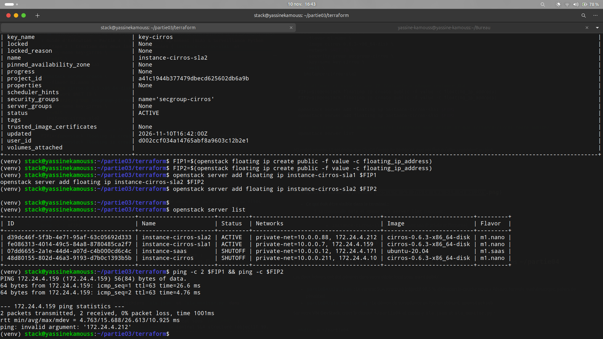
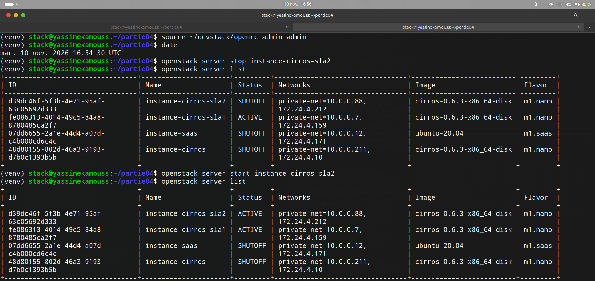
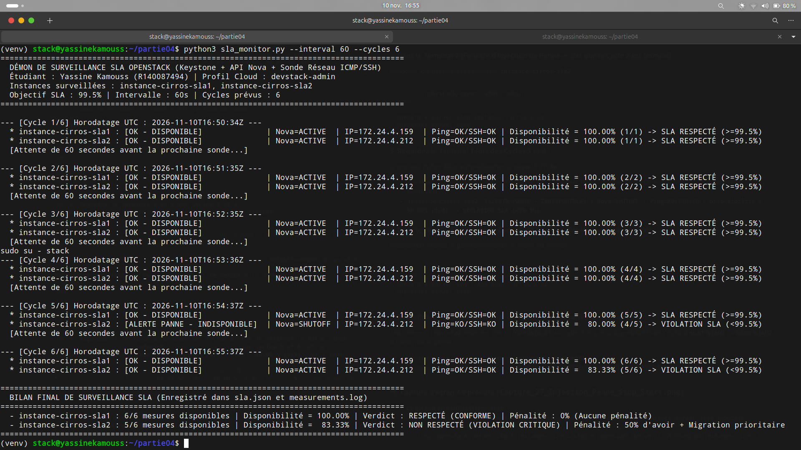
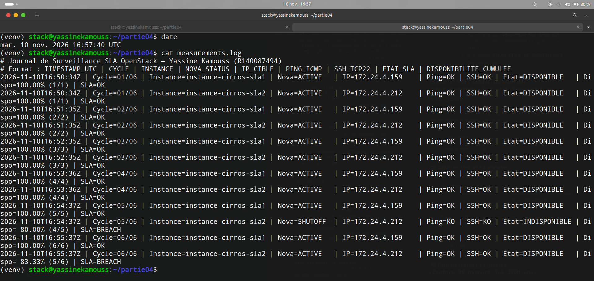
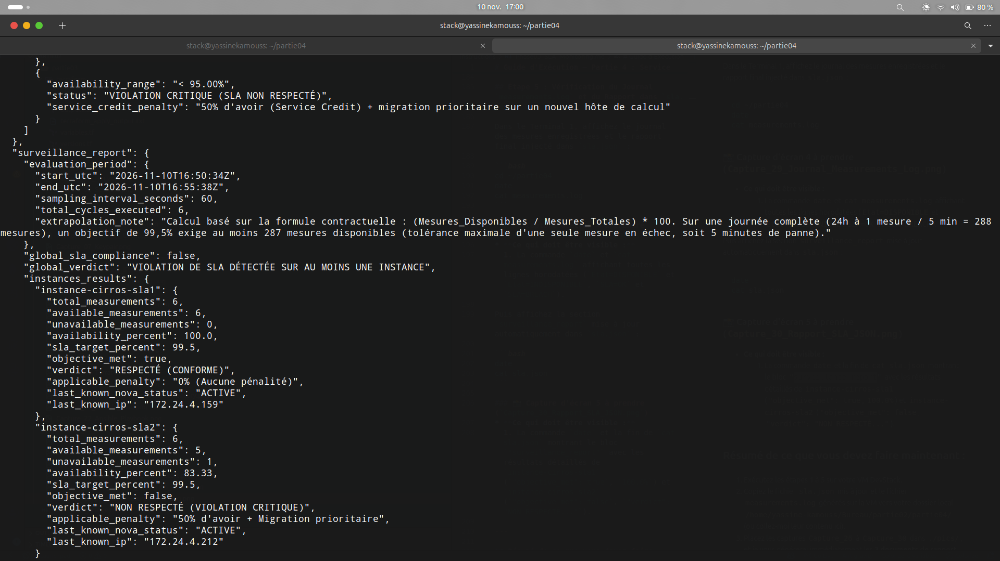

# Rapport Complet — Partie 4 : Service Level Agreement (SLA) et Surveillance Automatisée Python (`openstacksdk`)

**Étudiant :** Yassine Kamouss (`R140087494`)  
**Établissement :** Université Abdelmalek Essaâdi (UAE)  
**Module :** Cloud Intelligence — Projet de fin de partie  
**Technologies :** Python 3, `openstacksdk` (Keystone v3 & Nova Compute API), Sondes Réseau (ICMP Ping & Socket TCP/22 SSH), JSON SLA  

---

## Livrables de la Partie 4 dans ce dépôt
* **Contrat SLA et Rapport de Surveillance intégré :** [`../partie04/sla.json`](../partie04/sla.json)
* **Programme Python de Surveillance SLA (`openstacksdk`) :** [`../partie04/sla_monitor.py`](../partie04/sla_monitor.py)
* **Journal complet des mesures horodatées :** [`../partie04/measurements.log`](../partie04/measurements.log)
* **Sous-rapports détaillés par question :**
  * [`Partie4_Question1.md`](./Partie4_Question1.md) — Contrat SLA et démonstration mathématique sur 24h
  * [`Partie4_Question2_3.md`](./Partie4_Question2_3.md) — Architecture du démon Python `openstacksdk` et journalisation
  * [`Partie4_Question4_5.md`](./Partie4_Question4_5.md) — Simulation de panne, détection temps réel et rapport final SLA

---

## 1. Définition du Contrat SLA (`sla.json`) et Résolution Mathématique sur 24 Heures

### 1.1. Banc d'essai dédié (`instance-cirros-sla1` et `instance-cirros-sla2`)
Afin de conserver les instances de la Partie 2 intactes (`instance-cirros` et `instance-saas` à l'état `SHUTOFF`), nous avons provisionné deux instances CirrOS dédiées (`m1.nano`, 128 Mo RAM) :
* **`instance-cirros-sla1` (`172.24.4.159`) :** Instance témoin maintenue en haute disponibilité nominale.
* **`instance-cirros-sla2` (`172.24.4.212`) :** Instance cible soumise à une injection de panne contrôlée.



### 1.2. Clauses Techniques du Contrat `partie04/sla.json`
* **Objectif de disponibilité (SLO) :** **99,5 %** sur une période d'évaluation quotidienne (24 heures).
* **Définition bi-couche d'une instance « Disponible » :**
  1. **Plan de Contrôle (API Nova) :** `server.status == "ACTIVE"` et `power_state == 1`.
  2. **Plan de Données (Réseau) :** Réponse positive au **Ping ICMP** (timeout 2s) ou ouverture réussie d'un socket **TCP sur le port 22 SSH** (timeout 2s).
* **Fréquence de mesure :** Toutes les **5 minutes (300 secondes)**.
* **Formule de calcul :**
  $$\text{Disponibilité (\%)} = \left(\frac{\text{Mesures « disponible »}}{\text{Mesures totales}}\right) \times 100$$
* **Conséquences en cas de non-respect :** Journalisation d'une alerte `SLA=BREACH` et application d'avoirs financiers gradués (*Service Credits* de 10 %, 25 % ou 50 % + migration prioritaire).

### 1.3. Question du Rapport : Nombre d'échecs tolérés et durée de panne sur une journée
* **Nombre total de mesures par 24 heures (1 mesure / 5 min) :**
  $$N_{\text{total}} = \frac{24 \times 60}{5} = \frac{1\,440}{5} = \mathbf{288\text{ mesures/jour}}$$
* **Nombre maximal de mesures en échec tolérées pour rester $\ge 99,5\%$ :**
  $$N_{\text{échec}} \le 288 \times \left(1 - 0,995\right) = 288 \times 0,005 = 1,44 \implies \boxed{N_{\text{échec\_max}} = \mathbf{1\text{ seule mesure en échec}}}$$
  *(En effet, avec 1 échec : $\frac{287}{288} = 99,65\% \ge 99,5\%$ ; dès 2 échecs : $\frac{286}{288} = 99,31\% < 99,5\%$).*
* **Durée de panne correspondante :**
  * **En échantillonnage discret (pas de 5 minutes) :** 1 mesure en échec représente **$\mathbf{5\text{ minutes}}$** de panne maximale tolérée.
  * **En temps continu théorique :** $0,5\%$ de $1\,440\text{ minutes} = 7,2\text{ minutes} =$ **$\mathbf{7\text{ minutes et } 12\text{ secondes}}$**.

---

## 2. Programme Python de Surveillance (`sla_monitor.py`) et Journalisation

Le démon `partie04/sla_monitor.py` s'authentifie auprès de **Keystone** via `openstack.connect(cloud="devstack-admin")`, interroge l'API **Nova** (`conn.compute.get_server()`), exécute les sondes réseau **ICMP Ping** et **TCP/22 SSH**, écrit chaque mesure dans `measurements.log` et met à jour atomiquement le bloc `"surveillance_report"` dans `sla.json`.

---

## 3. Injection de Panne (`stop` / `start`), Détection Temps Réel et Rapport Final

Au cours de la campagne de surveillance (6 cycles de mesure), nous avons arrêté puis redémarré `instance-cirros-sla2` au Cycle 5 :

```bash
date
openstack server stop instance-cirros-sla2
openstack server list
openstack server start instance-cirros-sla2
openstack server list
```



### 3.1. Détection de la Panne par le Programme Python
Au Cycle 5 (`16:54:37Z`), `sla_monitor.py` détecte immédiatement `Nova=SHUTOFF | Ping=KO/SSH=KO` sur `instance-cirros-sla2`, affiche **`[ALERTE PANNE - INDISPONIBLE]`** et fait chuter sa disponibilité à **80,00 % (`4/5`)**, puis **83,33 % (`5/6`)** après redémarrage au Cycle 6 :



### 3.2. Journal des Mesures (`measurements.log`) et Rapport Final Intégré dans `sla.json`





| Instance surveillée | IP Flottante | Mesures Disponibles / Totales | Disponibilité Finale | Objectif ($\ge 99,5\%$) | Verdict Contractuel | Pénalité Applicable |
| :--- | :---: | :---: | :---: | :---: | :--- | :--- |
| **`instance-cirros-sla1`** *(Témoin)* | `172.24.4.159` | $6 / 6$ | **100,00 %** | **Respecté (`true`)** | `RESPECTÉ (CONFORME)` | 0 % (Aucune pénalité) |
| **`instance-cirros-sla2`** *(Cible panne)* | `172.24.4.212` | $5 / 6$ | **83,33 %** | **Non respecté (`false`)** | `NON RESPECTÉ (VIOLATION CRITIQUE)` | 50 % d'avoir + Migration prioritaire |
